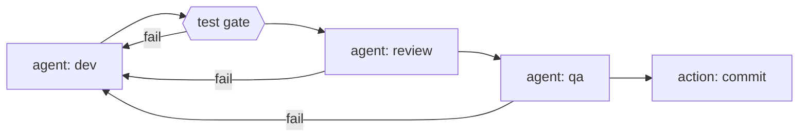

# agentic-dev-loop

> **Turn an LLM into a gated, sandboxed, resumable construction loop over your codebase.**

Describe your pipeline in one YAML file — agent steps, mechanical test gates, and
trusted actions — and `agentic-dev-loop` runs it end to end: agent and command steps get
kernel-level sandboxing via Docker, verdicts route the graph, every boundary is
checkpointed, and nothing gets committed until every gate passes.



- **A tool, not a wiring project.** One CLI entry point, opinionated defaults,
  fixed safety policies. You write the pipeline and the agent definitions —
  nothing else.
- **Deterministic.** Same pipeline + same state → same routing. Verdicts are
  parsed from files, retries are bounded, nothing is best-effort.
- **Sandboxed by default.** The agent's shell and every command step run inside
  an always-on Docker sandbox. There is no opt-out.

Two modes share one `pipeline.yaml`: **engine mode** (the sandboxed, resumable
loop above) and **workflow mode** — a Claude Dynamic Workflow exported from the
same pipeline that runs in Claude Code's own environment, with the live graph
visualiser. See [Workflow mode](#workflow-mode-claude-code).

---

## Core features

| Feature | What it gives you |
| --- | --- |
| **Stage-gated agent loop** | Agents do the work, test stages verify it, and the pipeline only advances when each stage passes its gates — looping back with full context when one fails. |
| **Kernel-level sandboxing** | Agent work and command stages run isolated from your machine: [no network access **by default** — authors opt specific stages in](#per-stage-networking), no writes outside your workspace. No sandbox available → the run stops instead of degrading. |
| **Crash-safe resume** | Interrupt a run at any time and pick it up later — finished stages stay finished, and you resume from exactly where it stopped. |
| **Live graph visualisation** | Follow every run in the browser: stage status, pass/fail verdicts, retry cycles, and live console output as it happens. |
| **Extensible** | Plug in your own actions, tools, and document loaders to adapt the loop to your projects. |

The fixed policies *are* the product: fail fast on missing config/secrets, no
silent fallbacks, verdicts only from artifacts, bounded retries, per-attempt
artifact hygiene, a single clean-worktree-gated commit point, and no default
LLM timeout (agent runs are long).

## Installation

**Prerequisites**

| Requirement | Detail |
| --- | --- |
| Python | ≥ 3.12 |
| Docker engine | Engine API ≥ 1.43 (Engine 24). Any compliant engine works — Docker Desktop, OrbStack, Colima, Rancher Desktop, podman docker-compat. On Windows, Linux-containers mode is required. |
| LLM API key | The env var named by your pipeline's `api_key_env` (e.g. `OPENAI_API_KEY`) must be set — a missing key fails fast, naming it. |

```bash
# engine mode (sandboxed loop — the full install)
pip install "agentic-dev-loop[engine]"
agentic-dev-loop --version

# workflow mode (Claude Code — core + viz only, no SDK/Docker deps)
pip install agentic-dev-loop
agentic-dev-loop-workflow install-skill
```

On the first run the engine pulls the **digest-pinned** dev image
(`ghcr.io/lukedawilson/agentic-dev-loop/dev`) and verifies its digest — the
supply-chain check refuses to continue on a mismatch. If you're running
pre-publish tooling, point `AGENTIC_DEV_LOOP_DEV_IMAGE` at your locally built
image. Engine setup, first-run details, the full `pipeline.yaml` contract, and
troubleshooting for every fail-fast code live in
[docs/setup.md](docs/setup.md).

## Workflow mode (Claude Code)

For developers who know and love the agentic dev loop but are forced to use
Claude Code at work: workflow mode exports a **Claude Dynamic Workflow** from
the `pipeline.yaml` they already trust, plus the visualiser they trust. It adds
the deterministic loop through Claude's mechanism — nothing more. **No Docker
sandboxing, and no new security claims**: workflow steps run in Claude Code's
own environment under its permission model (a documented trust-model change
from engine mode).

Install the skill once:

```bash
pip install agentic-dev-loop            # base install: core + viz, no SDK/Docker
agentic-dev-loop-workflow install-skill # → ~/.claude/skills/agentic-dev-loop/
```

Then invoke `/agentic-dev-loop` in Claude Code. The skill walks through:

1. **Build** — `python -m agentic_dev_loop.core.project <pipeline.yaml>` loads +
   validates the pipeline, verifies every agent step's `.agent.md` prompt exists
   (a missing prompt fails the build loudly, naming the file), and writes a
   self-contained `.agentic-dev-loop/workflow.js`. Steps are frozen at creation
   — mid-run `pipeline.yaml` edits never affect a running workflow.
2. **Run** — the generated JS routes `on_pass` / `on_fail` / `goto` with its own
   attempt counter, injects the failing subagent's output as the next retry note,
   launches the live-graph server (localhost, token-authenticated ingest), and
   invokes the docker-free commit shim, which refuses loudly unless the worktree
   was clean at run start.

Engine-only fields (`isolation:`, per-step `network:`, `setup:`) are ignored in
workflow mode with no effect on the build or run.

The base install is deliberately dependency-light (`pydantic` + `PyYAML` only);
the heavy OpenHands-SDK engine lives in the `[engine]` extra. The `core` and
`viz` packages are guarded against pulling engine deps.

## Usage

```bash
export OPENAI_API_KEY=...                          # whatever api_key_env names
agentic-dev-loop pipeline.yaml                     # run it
agentic-dev-loop pipeline.yaml --dry-run           # validate first — no LLM, no Docker
agentic-dev-loop pipeline.yaml --resume <thread-id> --max-attempts 5
```

| Flag | Effect |
| --- | --- |
| `--dry-run` | Full load-and-validate pass, then print the resolved plan. No LLM, no Docker, no state writes, no API key. Exit `0` on a clean load. |
| `--resume <thread-id>` | Continue the latest checkpoint of a previous run (crash, Ctrl-C, exhaustion) with all accumulated notes intact. |
| `--max-attempts <n>` | Override the pipeline's `max_attempts`. |
| `--refresh` | Force re-provision of every `setup:` hook (bypasses the stamp cache). |
| `--clean-stamps` | Delete cached provision stamps and exit. |
| `--no-viz` / `--viz-port <port>` | Suppress the live graph view / set a preferred port (default 8321; falls back to a free port when busy). |
| extension flags | Document-loader flags (e.g. `--plan`, `--aidlc-unit`) appear once the pipeline's extensions are loaded — `agentic-dev-loop PIPELINE --help` shows them. |

Exit code is `0` on pipeline success, `1` otherwise.

**What a run looks like** (the shipped self-loop example):


1. **dev** — the dev agent works with full context (loaded docs + shared files).
   Its edits are untracked; only declared `produces:` files are hygiene-tracked.
2. **test** — a mechanical command step runs the suite inside the sandbox.
   Exit 0 moves on; anything else rewinds to `dev` with the failing output.
3. **review / qa** — verdict agents write artifacts whose `VERDICT:` lines route
   the graph. `fail` rewinds to `dev` and consumes an attempt.
4. **commit** — the single commit point fires only when all gates passed and
   the worktree was clean at start.
5. **success** — committed; or **failure** when attempts are exhausted.

### pipeline.yaml reference

```yaml
name: my-construction-loop
extensions:
  - agentic_dev_loop.engine.extensions.aidlc:AidlcExtension   # bundled AI-DLC doc loader
additional_files:
  - ../README.md                                       # shared context for every agent step

llm:
  model: openai/deepseek-v4-pro
  base_url: https://api.deepseek.com
  api_key_env: OPENAI_API_KEY

max_attempts: 10                                        # CLI --max-attempts overrides
agents_dir: sdk_agents                                  # your <name>.agent.md files

steps:
  - name: dev
    agent: dev
    produces: implementation-summary.md
    on_pass: test

  - name: test
    command: .venv-sandbox/bin/python -m pytest tests/ -q -m "not docker"
    setup: python -m venv .venv-sandbox && .venv-sandbox/bin/pip install -e ".[dev]"
    timeout: 600
    on_pass: review
    on_fail: { goto: dev, retry: true }

  - name: review
    agent: review
    artifact: review-findings.md
    verdicts: { pass: APPROVED, fail: NEEDS CHANGES }
    on_pass: qa
    on_fail: { goto: dev, retry: true }

  - name: qa
    agent: qa
    artifact: qa-report.md
    verdicts: { pass: PASS, fail: FAIL }
    on_pass: commit
    on_fail: { goto: dev, retry: true }

  - name: commit
    action: commit
    params: { message: "feat: construct {subject} (agent dev loop)" }
```

| Key | Notes |
| --- | --- |
| `agent:` / `command:` / `action:` | Exactly one per step. Agents live in `agents_dir` as `<name>.agent.md`; commands run sandboxed (mechanical, never an LLM call); actions are registered host-side functions. |
| `produces:` / `artifact:` + `verdicts:` | Hygiene-tracked outputs vs verdict-parsed routing. The **last** `VERDICT:` line wins; stale artifacts are deleted at each attempt start. |
| `on_pass:` / `on_fail:` | A step name, terminal `success`/`failure`, or `{goto: X, retry: true}`. No loops happen unless you write them. |
| `env:` / `setup:` / `network:` | `env:` declares step vars (fixed safe base + declared vars only); `setup:` provisions the sandbox (command steps, network ON, stamp-cached); `network: true` grants egress to a command or agent step (default off) — see [Per-stage networking](#per-stage-networking). |
| `isolation:` (optional) | Configures the sandbox — image override, resource caps, `allow_git_mutations`. It can never disable it. |
| `state_dir` | Defaults to `~/.agentic-dev-loop/runs/<pipeline-hash>/` — artifacts and checkpoints live outside the sandbox mount. |

### Per-stage networking

The sandbox is network-off by default. A step that legitimately needs egress —
a QA step that curls a service it booted, an agent that must hit an API or
fetch package metadata mid-conversation — declares it explicitly:

```yaml
steps:
  - name: fetch-docs
    command: curl -fsSL https://example.com/spec.json -o spec.json
    network: true            # egress for this step only
```

- **Default off.** Every step runs with `--network none` unless it declares
  `network: true`. A networked step runs in a second, otherwise-identical
  sandbox container (`--read-only`, `--cap-drop ALL`, single workspace mount)
  on the Docker bridge network — the default network-none container is always
  created too, so no infrastructure work happens mid-run.
- **Command and agent steps** may declare it. Action steps are host-side and
  never take it (a load-time error).
- **Author opt-in is the control.** A networked step gives its agent raw
  egress for that stage; the default stays network-off everywhere. Reserve it
  for stages that need it (QA, integration). The residual risk is documented
  in [docs/setup.md](docs/setup.md).

## Development environment

```bash
git clone git@github.com:lukedawilson/agentic-dev-loop.git
cd agentic-dev-loop
./setup-venv.sh                       # idempotent .venv setup (never touches bare pip)
# create .env with your LLM key (loaded by trigger-agentic-dev-loop.sh, never committed):
#   echo 'OPENAI_API_KEY=...' > .env
python -m pytest tests/ -q            # fast suite
python -m pytest tests/ -q -m "not docker"   # skip engine-dependent tests
./trigger-agentic-dev-loop.sh --dry-run      # run the shipped pipeline against this repo
./run-demo.sh                         # viz demo — scripted run replay, no pipeline needed
```

- `setup-venv.sh` is safe to re-run and picks the right interpreter even on
  machines with exotic Python installations.
- Docker-marked integration tests need a local daemon; CI runs them on Linux.
- The shipped pipeline (`agentic-dev-loop/pipeline.yaml`) **dogfoods the tool on
  its own repo** — dev → test → review → qa → commit, with the engine's own
  three agent definitions in `sdk_agents/`.
- CI: `ci.yml` (unit + integration suite, ubuntu + windows),
  `publish-image.yml` (multi-arch dev image, amd64 + arm64), `release.yml`
  (PyPI publishing).

## Contributing

- **Read [AGENTS.md](AGENTS.md) first** — it is the instruction set for both
  human and agent contributors (default mode: the user drives, ask before
  coding, TDD, no silent fallbacks).
- Development is structured by **AI-DLC** — the lifecycle workflow in
  `.aidlc/aidlc-rules/aws-aidlc-rules/` with working docs (plans, units, state)
  in `aidlc-docs/`. The bundled document loader autodetects the current unit
  from `aidlc-state.md` via `--aidlc-unit`, or load any plan with `--plan`.
- OpenCode commands over the workflow: `/unit-status`, `/epic-status`,
  `/ticket-details`, `/update-subtask`, `/apply-aidlc-patches`, and more.
- Working extension samples (actions, tools, document loaders) ship as
  `tests/sample_ext.py`.

---

Built on [OpenHands SDK](https://github.com/OpenHands/software-agent-sdk) and
[LangGraph](https://github.com/langchain-ai/langgraph).
