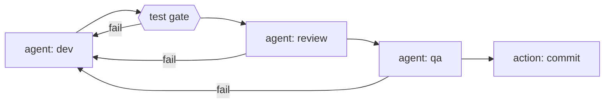
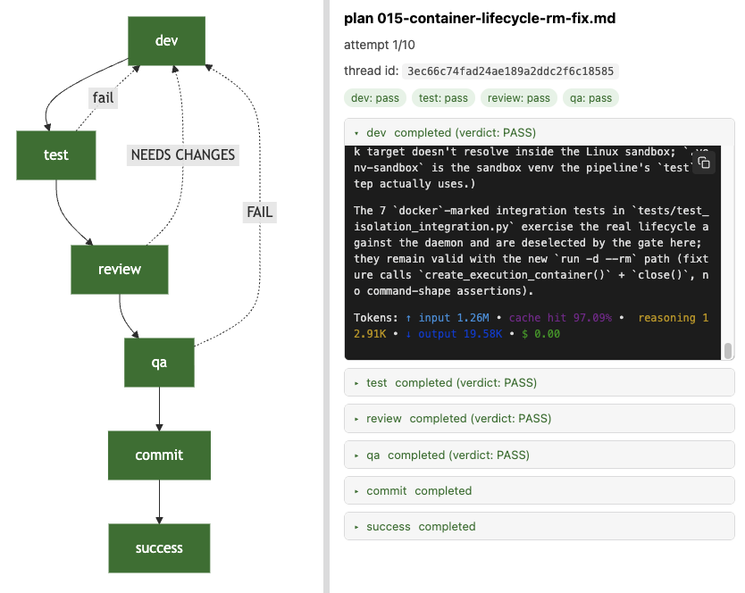

# agentic-dev-loop

> **Turn an LLM into a gated, sandboxed, resumable construction loop over your codebase.**

Describe your pipeline in one YAML file — agent steps, mechanical test gates, and
trusted actions — and `agentic-dev-loop` runs it end to end: agent and command steps get
kernel-level sandboxing via Docker, verdicts route the graph, every boundary is
checkpointed, and nothing gets committed until every gate passes.



- **A tool, not a wiring project.** One CLI entry point, opinionated defaults,
  fixed safety policies. You write the pipeline and the agent definitions —
  nothing else.
- **Deterministic.** Same pipeline + same state → same routing. Verdicts are
  parsed from files, retries are bounded, nothing is best-effort.
- **Sandboxed by default.** The agent's shell and every command step run inside
  an always-on Docker sandbox. There is no opt-out.

---

## Core features

| Feature | What it gives you |
| --- | --- |
| **Stage-gated agent loop** | Agents do the work, test stages verify it, and the pipeline only advances when each stage passes its gates — looping back with full context when one fails. |
| **Kernel-level sandboxing** | Agent work and command stages run isolated from your machine: [no network access **by default** — authors opt specific stages in](#per-stage-networking), no writes outside your workspace. No sandbox available → the run stops instead of degrading. |
| **Crash-safe resume** | Interrupt a run at any time and pick it up later — finished stages stay finished, and you resume from exactly where it stopped. |
| **Live graph visualisation** | Follow every run in the browser: stage status, pass/fail verdicts, retry cycles, and live console output as it happens. |
| **Extensible** | Plug in your own actions, tools, and document loaders to adapt the loop to your projects. |

The fixed policies *are* the product: fail fast on missing config/secrets, no
silent fallbacks, verdicts only from artifacts, bounded retries, per-attempt
artifact hygiene, a single clean-worktree-gated commit point, and no default
LLM timeout (agent runs are long).

## Installation

**Prerequisites**

| Requirement | Detail |
| --- | --- |
| Python | ≥ 3.12 |
| Docker engine | Engine API ≥ 1.43 (Engine 24). Any compliant engine works — Docker Desktop, OrbStack, Colima, Rancher Desktop, podman docker-compat. On Windows, Linux-containers mode is required. |
| LLM API key | The env var named by your pipeline's `api_key_env` (e.g. `OPENAI_API_KEY`) must be set — a missing key fails fast, naming it. |

```bash
pip install "agentic-dev-loop==1.0.0a9"
agentic-dev-loop --version
```

The canonical consumer install is **pipx**, which puts the engine's venv
*outside* the workspace — the sandbox mount set is exactly `{workspace}`, so an
out-of-workspace install is unmounted and never agent-writable:

```bash
pipx install "agentic-dev-loop==1.0.0a9"
```

If you install with `uv` shortly after a release, pass `--refresh` — PyPI
serves the package index with `Cache-Control: max-age=600`, and uv otherwise
reuses a pre-upload snapshot of the index for up to 10 minutes, reporting
"no version of agentic-dev-loop==X.Y.Z" for a version that is already live:

```bash
uv pip install --refresh "agentic-dev-loop==1.0.0a9"
```

On the first run the engine pulls the **digest-pinned** dev image
(`ghcr.io/lukedawilson/agentic-dev-loop/dev`) and verifies its digest — the
supply-chain check refuses to continue on a mismatch. If you're running
pre-publish tooling, point `AGENTIC_DEV_LOOP_DEV_IMAGE` at your locally built
image. Engine setup, first-run details, the full `pipeline.yaml` contract, and
troubleshooting for every fail-fast code live in
[docs/setup.md](docs/setup.md).

## Usage

```bash
export OPENAI_API_KEY=...                          # whatever api_key_env names
agentic-dev-loop pipeline.yaml                     # run it
agentic-dev-loop pipeline.yaml --dry-run           # validate first — no LLM, no Docker
agentic-dev-loop pipeline.yaml --resume <thread-id> --max-attempts 5
```

| Flag | Effect |
| --- | --- |
| `--dry-run` | Full load-and-validate pass, then print the resolved plan. No LLM, no Docker, no state writes, no API key. Exit `0` on a clean load. |
| `--resume <thread-id>` | Continue the latest checkpoint of a previous run (crash, Ctrl-C, exhaustion) with all accumulated notes intact. |
| `--max-attempts <n>` | Override the pipeline's `max_attempts`. |
| `--refresh` | Force re-provision of every `setup:` hook (bypasses the stamp cache). |
| `--clean-stamps` | Delete cached provision stamps and exit. |
| `--no-viz` / `--viz-port <port>` | Suppress the live graph view / set a preferred port (default 8321; falls back to a free port when busy). |
| extension flags | Document-loader flags (e.g. `--plan`, `--aidlc-unit`) appear once the pipeline's extensions are loaded — `agentic-dev-loop PIPELINE --help` shows them. |

Exit code is `0` on pipeline success, `1` otherwise.

**What a run looks like** (the shipped self-loop example):



1. **dev** — the dev agent works with full context (loaded docs + shared files).
   Its edits are untracked; only declared `produces:` files are hygiene-tracked.
2. **test** — a mechanical command step runs the suite inside the sandbox.
   Exit 0 moves on; anything else rewinds to `dev` with the failing output.
3. **review / qa** — verdict agents write artifacts whose `VERDICT:` lines route
   the graph. `fail` rewinds to `dev` and consumes an attempt.
4. **commit** — the single commit point fires only when all gates passed and
   the worktree was clean at start.
5. **success** — committed; or **failure** when attempts are exhausted.

### pipeline.yaml reference

```yaml
name: my-construction-loop
extensions:
  - agentic_dev_loop.engine.extensions.aidlc:AidlcExtension   # bundled AI-DLC doc loader
additional_files:
  - ../README.md                                       # shared context for every agent step

llm:
  model: openai/deepseek-v4-pro
  base_url: https://api.deepseek.com
  api_key_env: OPENAI_API_KEY

max_attempts: 10                                        # CLI --max-attempts overrides
agents_dir: sdk_agents                                  # your <name>.agent.md files

steps:
  - name: dev
    agent: dev
    produces: implementation-summary.md
    on_pass: test

  - name: test
    command: .venv-sandbox/bin/python -m pytest tests/ -q -m "not docker"
    setup: python -m venv .venv-sandbox && .venv-sandbox/bin/pip install -e ".[dev]"
    timeout: 600
    on_pass: review
    on_fail: { goto: dev, retry: true }

  - name: review
    agent: review
    artifact: review-findings.md
    verdicts: { pass: APPROVED, fail: NEEDS CHANGES }
    on_pass: qa
    on_fail: { goto: dev, retry: true }

  - name: qa
    agent: qa
    artifact: qa-report.md
    verdicts: { pass: PASS, fail: FAIL }
    on_pass: commit
    on_fail: { goto: dev, retry: true }

  - name: commit
    action: commit
    params: { message: "feat: construct {subject} (agent dev loop)" }
```

| Key | Notes |
| --- | --- |
| `agent:` / `command:` / `action:` | Exactly one per step. Agents live in `agents_dir` as `<name>.agent.md`; commands run sandboxed (mechanical, never an LLM call). `commit` is the sole host-side built-in action; consumer actions are sandbox-executed, command-shaped scripts (see [Host boundary](#host-boundary-security-model)). |
| `produces:` / `artifact:` + `verdicts:` | Hygiene-tracked outputs vs verdict-parsed routing. The **last** `VERDICT:` line wins; stale artifacts are deleted at each attempt start. |
| `on_pass:` / `on_fail:` | A step name, terminal `success`/`failure`, or `{goto: X, retry: true}`. No loops happen unless you write them. |
| `env:` / `setup:` / `network:` | `env:` declares step vars (fixed safe base + declared vars only); `setup:` provisions the sandbox (command steps, network ON, stamp-cached); `network: true` grants egress to a command or agent step (default off) — see [Per-stage networking](#per-stage-networking). |
| `secrets:` (top-level) / step `secrets:` | Declares secret **refs only — never values**; each step opts in to the refs it needs. Resolved host-side and injected into that step's exec env only. See [Secrets](#secrets--refs-only-never-values). |
| `isolation:` (optional) | Configures the sandbox — image override, resource caps, `allow_git_mutations`. It can never disable it. |
| `state_dir` | Defaults to `~/.agentic-dev-loop/runs/<pipeline-hash>/` — artifacts and checkpoints live outside the sandbox mount. |
| `extensions_dir` | Where consumer `extensions:` modules resolve — defaults to `~/.agentic-dev-loop/extensions`, **outside** the workspace. Workspace-resident extension/tool modules are refused at load. |
| `deps_policy` | `locked` (default) or `open`. `locked` = the human-owned lockfile is the source of truth and the agent may not add dependencies; `open` = the bootstrap protocol (the agent may add exact-pinned manifest entries). See [Dependency policy](#dependency-policy-locked-by-default). |
| `lockfiles` | The pipeline's declared lockfile names (workspace-relative), injected into agent context and named by the missing-dependency fail-fast. Required (non-empty) when `deps_policy: locked` — a `locked` pipeline with no lockfiles fails fast at load. |

### Secrets (`secrets:`) — refs only, never values

Secret values never belong in the pipeline yaml, the workspace, or `state_dir`.
Declare the refs at the top level and opt each step into the refs it needs:

```yaml
secrets:                              # refs only — never values
  kinde-client-secret:                # ref name (arbitrary)
    from: env                         # provider name
    key: KINDIE_CLIENT_SECRET         # provider-specific locator
  r2-keys:
    from: env
    key: YOSK_R2_KEYS

steps:
  - name: qa
    agent: qa
    secrets: [kinde-client-secret, r2-keys]
```

- The engine resolves every declared ref **host-side at run start** (the `env`
  provider reads the named host environment variable). A missing variable, an
  unknown provider, or a ref a step lists without declaring it fails fast —
  naming the ref, the step, and the provider error. No silent fallback.
- A resolved secret is injected into a step's exec env **only when that step
  lists the ref** — the same path step `env:` uses, no new channel. The secret
  never reaches the provision container, `state_dir`, or any other step.
- Prefer a mechanical `command` step for secret-consuming work (a script runs
  the app with creds) so the LLM and the secret never meet; an `agent` step
  holds a secret only when its job genuinely requires it.
- **`.env*` ban.** At run start the workspace root is scanned for `.env*`
  files. Any hit fails fast, naming the files, with the remedy text. The
  convention fixtures `.env.example`, `.env.template`, and `.env.sample` are
  whitelisted. This applies regardless of `network:` flags.
- **Output scrubbing.** Resolved secret values are scrubbed from every
  engine-written output — captured step output, retry notes, artifacts, and
  `state_dir` files. (Hygiene: the declaring step's agent has already seen
  the value in its own env.)

### Per-stage networking

The sandbox is network-off by default. A step that legitimately needs egress —
a QA step that curls a service it booted, an agent that must hit an API or
fetch package metadata mid-conversation — declares it explicitly:

```yaml
steps:
  - name: fetch-docs
    command: curl -fsSL https://example.com/spec.json -o spec.json
    network: true            # egress for this step only
```

- **Default off.** Every step runs with `--network none` unless it declares
  `network: true`. A networked step runs in a second, otherwise-identical
  sandbox container (`--read-only`, `--cap-drop ALL`, single workspace mount)
  on the Docker bridge network — the default network-none container is always
  created too, so no infrastructure work happens mid-run.
- **Command, agent, and sandbox-action steps** may declare it. The host-side
  built-in `commit` action never takes it (refused once the registry is known).
- **Author opt-in is the control.** A networked step gives its agent raw
  egress for that stage; the default stays network-off everywhere. Reserve it
  for stages that need it (QA, integration). The residual risk is documented
  in [docs/setup.md](docs/setup.md).

## Dependency policy (locked by default)

The supply-chain dial is a pipeline-level `deps_policy:` field, **locked by
default**. The engine injects the policy into every agent step's context —
the rule lives in the engine, not in hand-authored `dev.agent.md` prose (the
class of rule that deadlocked the NuGet cache).

```yaml
deps_policy: locked    # or: open    (default: locked)
lockfiles: [uv.lock]   # or: [packages.lock.json, package-lock.json]
```

- **`locked`** — the human-owned lockfile is the source of truth; the agent
  may not add dependencies. The injected rule says *"You may only use
  dependencies already present in `<lockfile>`. If the design requires a
  dependency that is not present, declare it in your final response under the
  fixed header `## Missing dependencies` (one `name==version` per line) and
  finish what you can. Do not add it to the manifest."* A non-empty
  `## Missing dependencies` declaration **fails the run fast** with
  `Extend <lockfile> with these pins and re-run: …` — one human lockfile edit,
  not a retry loop. The declaration is advisory to the human; the engine never
  auto-fetches the declared packages.
- **`open`** — the bootstrap protocol (018): the agent may add exact-pinned
  manifest entries directly (never a package-manager `add` command); the
  network-on restore step fetches them. The engine injects the same rule
  canonically. Nothing about `open` is default.

The **restore step** runs the toolchain's locked mode and fails when the
manifest and lockfile disagree:

| Toolchain | Locked restore | Lockfile |
| --- | --- | --- |
| .NET | `dotnet restore --locked-mode` | `packages.lock.json` (set `RestorePackagesWithLockFile=true`) |
| node | `npm ci` | `package-lock.json` |
| python | `uv sync --locked` (or pip-tools `pip-sync requirements.lock`) | `uv.lock` — pip has no native lockfile; `uv` is the canonical locked-install tool |

### Audit escalation in the restore step

The restore step also fails on known-CVE findings, at a per-toolchain
threshold:

| Toolchain | Audit (fails the step) |
| --- | --- |
| .NET | `NuGetAudit` at `error` — any audit finding fails the restore |
| node | `npm audit --audit-level=high` |
| python | `pip-audit` — any finding fails |

Under `locked`, a failing audit means the lockfile pins a vulnerable version:
the run fails and the human regenerates the lockfile at a patched version.
Under `open`, the failure routes to `dev` like any restore failure — the dev
agent can bump the pin, but that pin is audited again on the next pass, so
the loop self-corrects.

### Generating a lockfile

A human generates the lockfile once, on a network machine, and commits it —
the engine never fetches on the agent's behalf:

```bash
uv lock                 # python — writes uv.lock from pyproject.toml
uv sync --locked        # installs exactly uv.lock; fails on any drift
npm install --package-lock-only   # node — writes package-lock.json
npm ci                  # installs exactly package-lock.json
dotnet restore --use-lock-file   # .NET — writes packages.lock.json
dotnet restore --locked-mode      # installs exactly packages.lock.json
```

Keep the lockfile tracked (do not gitignore it) and re-run the locked restore
to prove it holds from a clean cache before setting `deps_policy: locked`.

## Host boundary (security model)

The orchestrator, tool layer, and the `commit` action run in the **host
process** — they hold your credentials and your full user account, so the
engine keeps anything agent-writable out of that process:

- **Consumer actions are sandbox-executed.** An action you register via an
  extension is a command-shaped script (`script + params`), run through the
  same sandbox path as command steps — the exit code is the verdict, and the
  code never runs in the host. Only the engine's trusted built-ins (`commit`,
  document loaders) run host-side.
- **Extensions load from outside the workspace.** `extensions_dir` defaults to
  `~/.agentic-dev-loop/extensions`; at load time any extension or tool module
  whose file resolves under the workspace is refused *before import*, naming
  the file.
- **The engine installs outside the workspace.** Install with pipx so the venv
  is unmounted from the sandbox; a startup self-check refuses to run if
  `agentic_dev_loop` resolves under the workspace (an editable install bypasses
  everything).
- **Tooling is read-only by the loop.** At run start the pipeline file,
  `agents_dir`, `additional_files`, `aidlc-docs/`, and `tools/` must be
  git-clean relative to HEAD — otherwise the run refuses, naming the dirty
  files. The `commit` action excludes those paths from its sweep, so the loop
  never commits its own tooling.
- **`commit` stays host-side, deliberately.** It holds push credentials; moving
  it into the sandbox would trade host-exec-of-trusted-code for
  credential-in-sandbox. It runs argv-style with a scrubbed child env and
  `-c core.hooksPath=~/.agentic-dev-loop/state/hooks` so repo hooks never
  execute.

Net: the host executes nothing from the workspace, reads only git-clean
control files, and the only agent-writable host-consumed thing left is the code
the loop is building.

### Consumer migration notes

- **Actions** — replace a host-side `fn` registration with
  `registry.add_sandbox_action(name, script)`. `script` is a command string
  rendered with the step's `params:` plus `{subject}`; the exit code is the
  verdict. `add_action` (host-side) is now engine-built-in-only and is refused
  from extensions.
- **Extensions** — move workspace-resident extension modules (e.g.
  `extensions/*.py`) into `~/.agentic-dev-loop/extensions/` (or whatever
  `extensions_dir:` names), and reinstall the engine via pipx so it is not
  editable/in-workspace.
- **Tooling** — commit the pipeline, agent defs, shared `additional_files`,
  `aidlc-docs/`, and `tools/` before running: the run refuses dirty tooling,
  and `commit` never commits it.

## Development environment

```bash
git clone git@github.com:lukedawilson/agentic-dev-loop.git
cd agentic-dev-loop
pipx install "agentic-dev-loop==1.0.0a9"   # engine venv OUTSIDE the workspace (self-check)
export OPENAI_API_KEY=...           # set your LLM key in the host env (no .env in the repo)
python -m pytest tests/ -q            # fast suite (in-repo .venv is for tests only)
python -m pytest tests/ -q -m "not docker"   # skip engine-dependent tests
agentic-dev-loop agentic-dev-loop/pipeline.yaml --dry-run   # run the shipped pipeline
./run-demo.sh                         # viz demo — scripted run replay, no pipeline needed
```

- `setup-venv.sh` builds the throwaway `.venv` for local `pytest` runs (the
  pipeline's `test` step provisions its own `.venv-sandbox` inside the
  sandbox). The loop itself must run from the pipx install — never an
  in-workspace `.venv`, which the startup self-check refuses.
- Docker-marked integration tests need a local daemon; CI runs them on Linux.
- The shipped pipeline (`agentic-dev-loop/pipeline.yaml`) **dogfoods the tool on
  its own repo** — dev → test → review → qa → commit, with the engine's own
  three agent definitions in `sdk_agents/`.
- CI: `ci.yml` (unit + integration suite, ubuntu + windows),
  `publish-image.yml` (multi-arch dev image, amd64 + arm64), `release.yml`
  (PyPI publishing).

## Contributing

- **Read [AGENTS.md](AGENTS.md) first** — it is the instruction set for both
  human and agent contributors (default mode: the user drives, ask before
  coding, TDD, no silent fallbacks).
- Development is structured by **AI-DLC** — the lifecycle workflow in
  `.aidlc/aidlc-rules/aws-aidlc-rules/` with working docs (plans, units, state)
  in `aidlc-docs/`. The bundled document loader autodetects the current unit
  from `aidlc-state.md` via `--aidlc-unit`, or load any plan with `--plan`.
- OpenCode commands over the workflow: `/unit-status`, `/epic-status`,
  `/ticket-details`, `/update-subtask`, `/apply-aidlc-patches`, and more.
- Working extension samples (actions, tools, document loaders) ship as
  `tests/sample_ext.py`.

---

Built on [OpenHands SDK](https://github.com/OpenHands/software-agent-sdk) and
[LangGraph](https://github.com/langchain-ai/langgraph).
