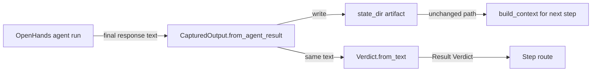

# Business Logic Model - unit-1 (output-passing fix)

## Core Flow

The unit replaces the agent-file-write feedback channel with pipeline capture of the agent's **final SDK response**. The business flow per agent step:

1. `StagesRuntime.run_agent` executes the agent (OpenHands SDK).
2. The SDK returns a result; the **final response text** is extracted from it.
3. `CapturedOutput.from_agent_result(result, step, state_dir)` builds the capture.
4. `CapturedOutput.write()` writes the artifact to the step's existing path (`produces:`/`artifact:` name under `state_dir`) - same path as before, so `build_context` and downstream steps are untouched.
5. `Verdict.from_text(captured_text)` parses the verdict from the same captured text (verdict-bearing steps only).
6. Routing uses the typed verdict exactly as before (existing retry semantics preserved).

## Key Decisions (from FD Q&A)

| Decision | Rule |
| --- | --- |
| FD-1 | Capture replaces exactly the `produces:`/`artifact:` channels. Terminal-produced working files (code edits, test runs) untouched. |
| FD-2 | Verdict semantics unchanged (last decoration-tolerant `VERDICT:` line wins, caveat delimiters, negation on 2-key sets) but returns typed `Result[Verdict]` - NO_VERDICT / AMBIGUOUS - never exceptions. |
| FD-3 | Verdict-first truncation retained for the verdict channel; summary artifact keeps the full response; `build_context` truncates to its budget. |
| FD-4 | Empty/errored final response = attempt failure → increment attempt, retry with note. |
| FD-5 | Implicit capture - pipeline YAML schema unchanged; no new keys; no opt-out. |

## Algorithms

**Final-response extraction.** From the SDK agent result, the final assistant message text is extracted. Empty string or agent error (no final message) → attempt failure (FD-4).

**Verdict extraction** (`Verdict.from_text`): scan the captured text for `VERDICT:` lines; tolerate markdown decoration (`**VERDICT: PASS**`); the **last** occurrence wins; negation applies on 2-key sets (e.g. seeing both `PASS` and `FAIL` in the same text → AMBIGUOUS, not last-wins-blindly - preserves the existing parser's bug-fixed behavior). No `VERDICT:` line → NO_VERDICT. Multiple conflicting keys without a clear last → AMBIGUOUS. Both NO_VERDICT and AMBIGUOUS feed the existing unclear-verdict retry path (attempt-bounded, never silently routable).

**Artifact write** (`CapturedOutput.write`): truncation policy per FD-3; writes to `state_dir/<artifact-name>`; pre-existing stale-artifact hygiene (delete at attempt start) unchanged.

## Data Flow

## PBT Property Identification (PBT-01)

| Property | Function | Hypothesis strategy |
| --- | --- | --- |
| Last-line-wins | `Verdict.from_text` | random verdict sequences + trailing prose |
| Decoration invariance | `Verdict.from_text` | wrap `VERDICT: X` in markdown bold/italics → same verdict |
| NO_VERDICT on verdict-free text | `Verdict.from_text` | arbitrary prose without the keyword |
| Round-trip write/read | `CapturedOutput` | write to temp dir, read back identical text |
| Empty response → attempt failure | `CapturedOutput.from_agent_result` | empty string / error result |
