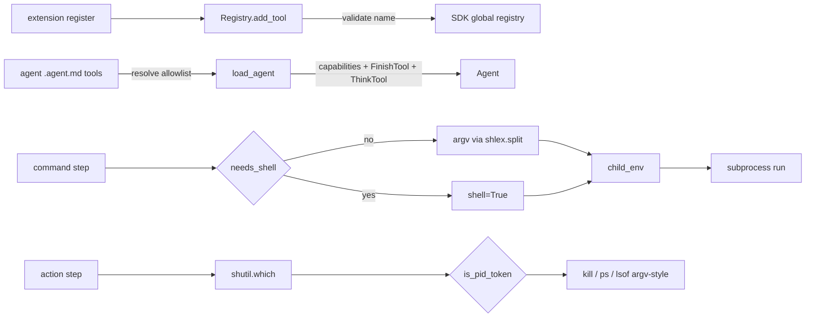

# Business Logic Model - unit-2 (SDK-level hardening)

## Core Flow

Unit 2 hardens the host-side surfaces a pipeline exposes to an agent, with no new opt-in flags. The business flow splits into two runtime contexts:

**Load time (once, graph build):**
1. `load_extensions` imports each `module:Class` and calls `ext.register(registry)`.
2. `Registry.add_tool(name, tool)` validates the name **before** registering (BR-3): non-empty identifier, no collision with any name already in the SDK global registry. Violation → loud error naming the extension.
3. `load_agent` resolves the agent's `tools:` allowlist against the SDK registry; unknown names already fail fast (preserved). The resolved tool surface is exactly `tools:` capabilities + `FinishTool` + `ThinkTool` (BR-1).

**Run time (per step):**
4. A **command step** classifies its command string: no shell metacharacters → `shlex`-split to argv and run shell-free; otherwise run via the shell. Both paths build a scrubbed child environment (BR-4).
5. An **action step** (`commit`, port-sweep) runs `git`/`lsof`/`ps`/`kill` argv-style with `shell=False`; pid tokens from `lsof` output are validated numeric before use; binaries resolved via `shutil.which` (BR-5).

## Key Decisions (from FD Q&A)

| Decision | Rule |
| --- | --- |
| FD-1 | Drop the "create task tracker entries" instruction from `dev.agent.md`; dev stays terminal-only (task_tracker is non-essential bookkeeping - the pipeline owns cross-step progress). |
| FD-2 | `tools:` is the exact *capability* allowlist; `FinishTool` (done signal) + `ThinkTool` (reasoning scaffold) are always present as infra. Empty `tools:` → the agent can think + finish but touch nothing. |
| FD-2b | `filter_tools_regex` dropped - the explicit allowlist is the whole story; no regex surface to harden or test. |
| FD-3 | Command steps: hybrid shell - `shlex`-split to argv when no shell metacharacters, keep `shell=True` for complex commands, env hygiene in both. |
| FD-4 | Tool-name collision = any name already in the SDK global registry (`list_registered_tools()`) + non-empty identifier. |
| FD-5 | Action steps: deeper - pid-token validation + `shutil.which` binary resolution + explicit `shell=False` + env hygiene. |

## Algorithms

**Tool-name validation** (`Registry.add_tool`): reject an empty/whitespace name; reject a name already returned by the SDK's `list_registered_tools()` (covers built-ins, prior extensions, and prior registrations - the SDK currently *silently overwrites* on duplicate, so agent-engine validates first). Fail fast at load (BR-3).

**Command classification** (`needs_shell`): scan the command string for shell metacharacters (`&&`, `|`, `;`, `>`, `<`, `$`, backticks, `~`, glob chars). Absent → simple command. Present → shell command. Pure function.

**Command split** (`split_command`): `shlex.split` a simple command into an argv list. The result is used only when `needs_shell` is false - `shlex` is never applied to a shell command (BR-4).

**Child environment** (`child_env`): build the subprocess environment from a fixed known-safe whitelist (`PATH` + the minimal vars tests/git need), plus the `llm.api_key_env` value (included by default), plus an explicit, author-extensible `env_allowlist` (a new optional config key). Everything else is excluded unless allowlisted (BR-4, BR-5, NFR-1 = C). Pure function over a mapping + allowlist.

**Pid-token validation** (`is_pid_token`): a token from `lsof` output is usable only if it is a plain decimal integer. Anything else (empty, `-9`, `1;rm`, whitespace) is rejected before it reaches `kill`/`ps` (BR-5). Pure function.

**Binary resolution**: `shutil.which("git"|"lsof"|"ps"|"kill")` resolves each program to an absolute path at call time; a missing binary is handled per the existing fail-safe contract (positive-only attribution, loud warning) rather than raising mid-run.

## Data Flow

## PBT Property Identification (PBT-02)

| Property | Function | Hypothesis strategy |
| --- | --- | --- |
| Metacharacter detection | `needs_shell` | random strings; those containing any of `&&`/`\|`/`;`/`>`/`$` → True, plain word sequences → False |
| Split/join round-trip | `split_command` | simple `shlex`-splittable commands split and re-join to the original; commands with metacharacters never passed to it |
| Numeric-token gate | `is_pid_token` | digit strings → True; `-9`, `1;rm`, ``, ` 123`, `12a` → False |
| Name validation | tool-name validator | empty/whitespace → reject; valid identifier → accept; any registered name → reject as collision |
| Env scrubbing | `child_env` | every returned mapping contains the api-key env var; all other parent vars appear only when allowlisted |
