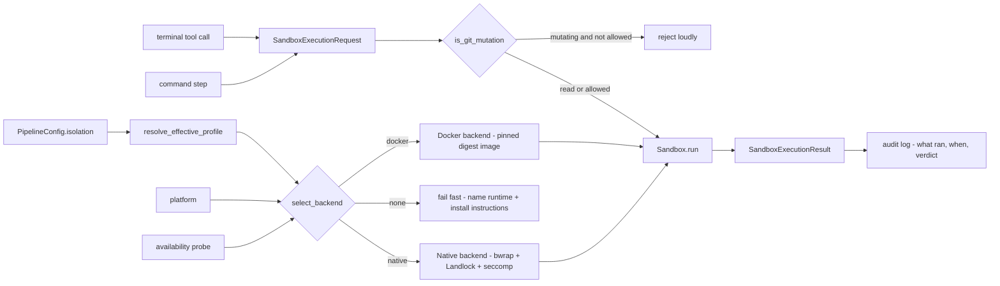

# Business Logic Model — unit-3 (always-on sandbox isolation)

## Core Flow

Unit 3 moves the two agent-influence channels — the `terminal` tool and command steps — inside an isolation boundary that is **always on** (FD-4). The business flow splits into two runtime contexts:

**Load time (once, pipeline build):**
1. Config load validates the optional `isolation:` section (unknown keys → loud error) and resolves the **effective profile**: opinionated defaults (network-egress blocked, rootfs read-only, writes restricted to workspace/state_dir, capabilities dropped, git mutations blocked) merged with author overrides (BR-5).
2. **Backend selection**: platform + availability probe + optional override knob → exactly one backend (Docker on macOS/Windows; native bwrap/Landlock/seccomp on Linux by default). No usable backend ⇒ fail fast, naming the missing runtime and install instructions — there is no unsandboxed fallback (BR-2/3/4/8).
3. Docker backend: ensure the harness-pinned default image (digest-verified) is present; pull with bounded retry (BR-10). Native backend: probe bwrap + kernel features; unusable ⇒ fail fast.

**Run time (per sandboxed step — a terminal-tool call or a command step):**
4. Build a `SandboxExecutionRequest`: argv, cwd, scrubbed env (`child_env` from unit-2), timeout, workspace/state_dir mounts.
5. Git-mutation guard (pre-exec): `is_git_mutation(argv)` + profile knob — mutating git ops are rejected loudly by default (BR-6).
6. `Sandbox.run(request)`: create the container/namespace per step → execute → capture stdout/stderr/exit code → destroy (always, including error paths) → return a `SandboxExecutionResult` (BR-1, BR-8.3).
7. Exit-code-is-the-verdict semantics unchanged (unit-2 BR-4.4); every sandboxed execution is audit-logged (BR-11).

## Key Decisions (from FD Q&A)

| Decision | Rule |
| --- | --- |
| FD-1 | Default profile = most conservative: network-egress blocked + writes restricted to the bind-mounted workspace/state_dir. |
| FD-2 | Two backends: Docker on macOS/Windows, native namespace isolation (bubblewrap/Landlock/seccomp) on Linux. The shared `Sandbox` interface is extracted now — the second implementation exists from day one, so extraction happens at the last responsible moment, not prematurely. FR-2.2 scope amended: the abstraction is the Sandbox surface; the Docker Engine API is the macOS/Windows backend behind it. |
| FD-2b | Native backend uses the host toolchain inside namespaces (bwrap read-only bind of the host toolchain, tmpfs scratch, rw bind of workspace/state_dir, Landlock + seccomp). No image on Linux. |
| FD-2c | Linux is native-only by default; fail fast when bwrap/kernel features are unusable. An explicit backend-selection knob lets a user choose Docker on Linux. |
| FD-3 | Boundary confirmed per FR-2.1: `terminal` tool + command steps inside; action steps, LangGraph runtime, LLM calls, viz server, commit stay host-side. |
| FD-3c | NEW: block ALL repo-mutating git operations inside the sandbox by default (commit, push, reset, branch/tag create/delete, stash, merge, rebase, worktree add …); reads (status/log/diff) always allowed; one profile knob re-allows mutations per-pipeline. |
| FD-4 | **Always-on (user directive, supersedes opt-in):** isolation is mandatory — no foot-gun toggle. FR-2.3 ⇒ no usable runtime ⇒ fail fast ALWAYS, including the self-hosted dev loop. The `isolation:` section configures the always-on sandbox; it can never disable it. |
| FD-4b | The `isolation:` section is optional with opinionated defaults: default profile (FD-1 + FD-3c), harness-pinned default image (digest), auto-detected backend with an override knob. Minimal pipelines need no section; the sandbox is active regardless. |
| FD-5 | Fake at the `Sandbox` interface level (the extracted interface gives the fake its shape); pure translation logic tested everywhere; real-backend integration tests marked + opt-in, never silently skipped. |
| Testability constraint (user) | Pure/translation logic is platform-independent and unit-tested on every dev machine. Native-backend integration tests run on a GitHub Actions Linux runner (and/or an optional lima VM); the macOS dev loop exercises the Docker backend; the CI workflow ships as part of unit-3. |

## Algorithms

**Effective profile resolution** (`resolve_effective_profile(defaults, overrides)`): merge the harness defaults with the author's `isolation.profile` overrides; validate keys (unknown key → load error) and knob values (e.g. `allow_git_mutations: bool`). Pure function (BR-5).

**Backend selection** (`select_backend(platform, probe, override)`): macOS/Windows → Docker (native unsupported there); Linux → native unless `backend: docker`; probe failure + no usable backend → loud failure naming the runtime (BR-4). Pure decision over probe results — the probe itself is an IO adapter, faked in tests (FD-5).

**Docker payload translation** (`docker_create_payload(profile, request)`): profile → container-create payload: network mode none, read-only rootfs, capabilities dropped, workspace/state_dir bind mounts rw, everything else absent, scrubbed env. Pure function (BR-5).

**bwrap argv translation** (`bwrap_argv(profile, request)`): profile → bubblewrap arguments: read-only bind of the host toolchain, tmpfs scratch, rw bind of workspace/state_dir, `--unshare-net`, `--die-with-parent`, seccomp filter path. Pure function (BR-5).

**Kernel policy serialisation** (`landlock_ruleset(profile)`, `seccomp_policy(profile)`): profile → Landlock access rules (workspace/state_dir read-write, everything else no-access) and seccomp BPF policy. Pure functions (BR-5).

**Mount-path translation** (`translate_mount_path(host_path, platform)`): host path → guest path per platform (WSL2 translation on Windows, identity elsewhere). Pure function, unit-tested with per-platform fixtures (BR-4.5).

**Git-mutation classification** (`is_git_mutation(argv)`): normalise global git options (`-c`, `-C`, `--git-dir`, `--work-tree`), inspect the subcommand. Known-read set (status, log, diff, show, ls-files, rev-parse, blame, describe, for-each-ref, branch/tag with no mutating arguments) → read, allowed. Anything else (including unknown subcommands) → mutation, subject to the profile knob. Deny-by-default (BR-6). Pure predicate.

**Env scrubbing**: reuse unit-2 `child_env` (fixed known-safe whitelist + `llm.api_key_env` value + author-extensible `env_allowlist`); the scrubbed env is what enters the sandbox — the host env is never passed wholesale (BR-9.1).

## Data Flow

## PBT Property Identification (PBT-03)

| Property | Function | Hypothesis strategy |
| --- | --- | --- |
| Network-off invariant | `docker_create_payload` / `bwrap_argv` | any profile without explicit network relaxation → generated payload/argv sets network isolation; relaxed profiles still produce a valid shape |
| Writes-only-on-mounts invariant | `docker_create_payload` / `bwrap_argv` / `landlock_ruleset` | every generated payload binds workspace/state_dir rw; rootfs read-only; no other rw path ever appears |
| Capability floor invariant | both translators | generated payload never *adds* capabilities beyond the profile's set; default profile drops all |
| Request/result round-trip (PBT-02) | request/result serialisation | random valid requests serialise and deserialise to equal values |
| Mount translation idempotence (PBT-02) | `translate_mount_path` | translating twice (per-platform fixtures) returns the original |
| Git classifier deny-by-default | `is_git_mutation` | any subcommand outside the known-read set → mutation; every known-read member → read |
| Selection totality | `select_backend` | for every platform × probe × override combination the result is exactly one backend or a loud failure — never "no decision" |
