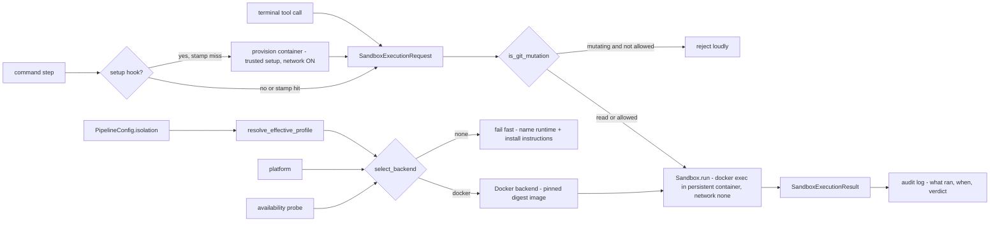

# Business Logic Model — unit-3 (always-on sandbox isolation)

> **NFR-stage amendments (2026-10-19)**: native Linux backend dropped (user directive — Docker everywhere, `Sandbox` surface retained as extension seam); per-step `env:` mapping (NFR-1); persistent-per-run lifecycle (NFR-2); `docker` CLI transport (NFR-3); per-step `setup:` hook with stamp caching (NFR-5); Windows CI (NFR-6). Amended sections below carry these changes.

## Core Flow

Unit 3 moves the two agent-influence channels — the `terminal` tool and command steps — inside an isolation boundary that is **always on** (FD-4). The business flow splits into two runtime contexts:

**Load time (once, pipeline build):**
1. Config load validates the optional `isolation:` section (unknown keys → loud error) and resolves the **effective profile**: opinionated defaults (network-egress blocked, rootfs read-only, writes restricted to workspace/state_dir, capabilities dropped, git mutations blocked) merged with author overrides (BR-5).
2. **Backend selection**: platform + availability probe (unix socket on macOS/Linux, npipe/WSL2 on Windows) → the Docker backend on all platforms. No usable daemon ⇒ fail fast, naming the missing runtime and install instructions — there is no unsandboxed fallback (BR-2/3/4/8).
3. Docker backend: ensure the harness-pinned default image (digest-verified) is present; pull with bounded retry (BR-10). Two container roles per run: **provision** (short-lived, network ON — runs step `setup:` hooks) and **execution** (`--network none`, persistent per run — BR-13/NFR-2).

**Run time (per sandboxed step — a terminal-tool call or a command step):**
4. Build a `SandboxExecutionRequest`: argv, cwd, the step's declared env (NFR-1 per-step `env:` mapping over a fixed safe base), timeout, workspace/state_dir mounts.
5. Command steps with a `setup:` hook run the setup in the provision container first (stamp-cached; BR-13). Git-mutation guard (pre-exec): `is_git_mutation(argv)` + profile knob — mutating git ops are rejected loudly by default (BR-6).
6. `Sandbox.run(request)`: execute in the persistent execution container (`docker exec` per request) → capture stdout/stderr/exit code → container destroyed at pipeline end and on all error paths → return a `SandboxExecutionResult` (BR-1, BR-8.3, NFR-2).
7. Exit-code-is-the-verdict semantics unchanged (unit-2 BR-4.4); every sandboxed execution is audit-logged (BR-11).

## Key Decisions (from FD Q&A)

| Decision | Rule |
| --- | --- |
| FD-1 | Default profile = most conservative: network-egress blocked + writes restricted to the bind-mounted workspace/state_dir. |
| FD-2 | ~~Two backends: Docker on macOS/Windows, native namespace isolation (bubblewrap/Landlock/seccomp) on Linux.~~ **Amended (NFR stage, user directive 2026-10-19):** Docker is the only backend on all platforms. The `Sandbox` interface is retained as the extension seam for future backends. |
| FD-2b | ~~Native backend uses the host toolchain inside namespaces (bwrap read-only bind, tmpfs scratch, Landlock + seccomp). No image on Linux.~~ **Amended:** removed with the native backend. |
| FD-2c | ~~Linux is native-only by default; fail fast when bwrap/kernel features are unusable. Explicit backend-selection knob for Docker on Linux.~~ **Amended:** Linux uses Docker like every other platform; the `backend:` override knob is removed (no second backend to select). |
| FD-3 | Boundary confirmed per FR-2.1: `terminal` tool + command steps inside; action steps, LangGraph runtime, LLM calls, viz server, commit stay host-side. |
| FD-3c | NEW: block ALL repo-mutating git operations inside the sandbox by default (commit, push, reset, branch/tag create/delete, stash, merge, rebase, worktree add …); reads (status/log/diff) always allowed; one profile knob re-allows mutations per-pipeline. |
| FD-4 | **Always-on (user directive, supersedes opt-in):** isolation is mandatory — no foot-gun toggle. FR-2.3 ⇒ no usable runtime ⇒ fail fast ALWAYS, including the self-hosted dev loop. The `isolation:` section configures the always-on sandbox; it can never disable it. |
| FD-4b | The `isolation:` section is optional with opinionated defaults: default profile (FD-1 + FD-3c), harness-pinned default image (digest), auto-detected daemon. Minimal pipelines need no section; the sandbox is active regardless. |
| FD-5 | Fake at the `Sandbox` interface level (the extracted interface gives the fake its shape); pure translation logic tested everywhere; real-backend integration tests marked + opt-in, never silently skipped. |
| NFR-1 | Per-step `env:` mapping — sandbox env = fixed safe base + the step's declared env only; `env_allowlist` never leaks into the sandbox; LLM key never auto-included inside. |
| NFR-2 | Persistent-per-run lifecycle — Docker container created lazily at first sandboxed exec, `docker exec` per request, destroyed at pipeline end + error paths. |
| NFR-5 | Per-step `setup:` hook — trusted author provisioning command (stack-agnostic: npm/dotnet/…), runs in the provision container with network ON; outputs land in the bind-mounted workspace; execution phase stays frozen. Stamp caching in `state_dir` keyed by setup command + lockfile hashes; `isolation.refresh` / `--refresh` forces re-provision. Agent terminal never runs setup, never gets network. |
| Testability constraint (user) | Pure/translation logic is platform-independent and unit-tested on every dev machine. Docker-backend integration tests run on GitHub Actions ubuntu-latest + windows-latest runners; the macOS dev loop exercises the Docker backend; the CI workflows ship as part of unit-3. |

## Algorithms

**Effective profile resolution** (`resolve_effective_profile(defaults, overrides)`): merge the harness defaults with the author's `isolation.profile` overrides; validate keys (unknown key → load error) and knob values (e.g. `allow_git_mutations: bool`). Pure function (BR-5).

**Backend selection** (`select_backend(platform, probe)`): macOS/Linux/Windows → Docker; probe failure → loud failure naming the runtime and install instructions (BR-4). Pure decision over probe results — the probe itself is an IO adapter, faked in tests (FD-5).

**Sandbox env resolution** (`resolve_sandbox_env(fixed_base, declared_env, host_env)`): fixed safe base (PATH/HOME/LANG/LC_ALL/TERM) + the step's declared `env:` mapping (null values inherit from the host env). The global `env_allowlist` is not consulted; the LLM key is included only if explicitly declared (NFR-1/BR-9). Pure function.

**Docker payload translation** (`docker_create_payload(profile, request)`): profile → container-create payload: network mode none, read-only rootfs, capabilities dropped, workspace/state_dir bind mounts rw, everything else absent, resolved sandbox env. Pure function (BR-5).

**Setup stamp key** (`setup_stamp_key(setup_cmd, lockfile_hashes)`): stable cache key for the provision stamp (BR-13). Pure function.

**Mount-path translation** (`translate_mount_path(host_path, platform)`): host path → guest path per platform (WSL2 translation on Windows, identity elsewhere). Pure function, unit-tested with per-platform fixtures (BR-4.5).

**Git-mutation classification** (`is_git_mutation(argv)`): normalise global git options (`-c`, `-C`, `--git-dir`, `--work-tree`), inspect the subcommand. Known-read set (status, log, diff, show, ls-files, rev-parse, blame, describe, for-each-ref, branch/tag with no mutating arguments) → read, allowed. Anything else (including unknown subcommands) → mutation, subject to the profile knob. Deny-by-default (BR-6). Pure predicate.

**Env scrubbing**: host-side command/action steps keep unit-2 `child_env` unless the step declares `env:` (then the declared env IS the allowlist for that step). Sandboxed executions use `resolve_sandbox_env` — the host env is never passed wholesale (BR-9, NFR-1).

## Data Flow

## PBT Property Identification (PBT-03)

| Property | Function | Hypothesis strategy |
| --- | --- | --- |
| Network-off invariant | `docker_create_payload` | any profile without explicit network relaxation → generated payload sets network isolation; relaxed profiles still produce a valid shape |
| Writes-only-on-mounts invariant | `docker_create_payload` | every generated payload binds workspace/state_dir rw; rootfs read-only; no other rw path ever appears |
| Capability floor invariant | `docker_create_payload` | generated payload never *adds* capabilities beyond the profile's set; default profile drops all |
| Sandbox-env scrub invariant | `resolve_sandbox_env` | for any fixed base + declared env, the LLM key and all non-declared names are absent; null-declared names inherit from host |
| Stamp-key stability | `setup_stamp_key` | same (setup, lockfiles) → same key; any input change → different key |
| Request/result round-trip (PBT-02) | request/result serialisation | random valid requests serialise and deserialise to equal values |
| Mount translation idempotence (PBT-02) | `translate_mount_path` | translating twice (per-platform fixtures) returns the original |
| Git classifier deny-by-default | `is_git_mutation` | any subcommand outside the known-read set → mutation; every known-read member → read |
| Selection totality | `select_backend` | for every platform × probe combination the result is Docker or a loud failure — never "no decision" |

## Amendment (2026-10-19) — loop-mechanics hardening

- **Load time (eager startup, Q2)**: probe → image ensure → execution container create+start → pre-provision ALL declared setups (stamp-cached) → graph build. Zero infra operations mid-run.
- **Mount invariant (Q1)**: payload builders take workspace only; mount set == {workspace}; PBT-03 single-mount invariant replaces the two-mount one.
- **Run state (Q1)**: PipelineConfig.state_dir default → `~/.agentic-dev-loop/runs/<pipeline-hash>/`.
- Git guard unchanged; commit action adds trusted hooksPath (Q3) — see business-rules.md.

## Amendment (2026-10-19) — package rename

- Package references updated `agent-engine` → `agentic-dev-loop` throughout (module paths, default image `ghcr.io/lukedawilson/agentic-dev-loop/dev`, env var `AGENTIC_DEV_LOOP_DEV_IMAGE`, user state dirs `~/.agentic-dev-loop/*`). No design change.
