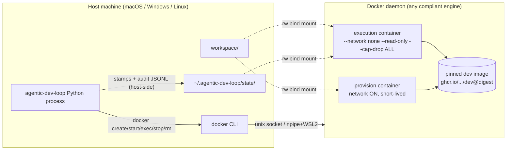
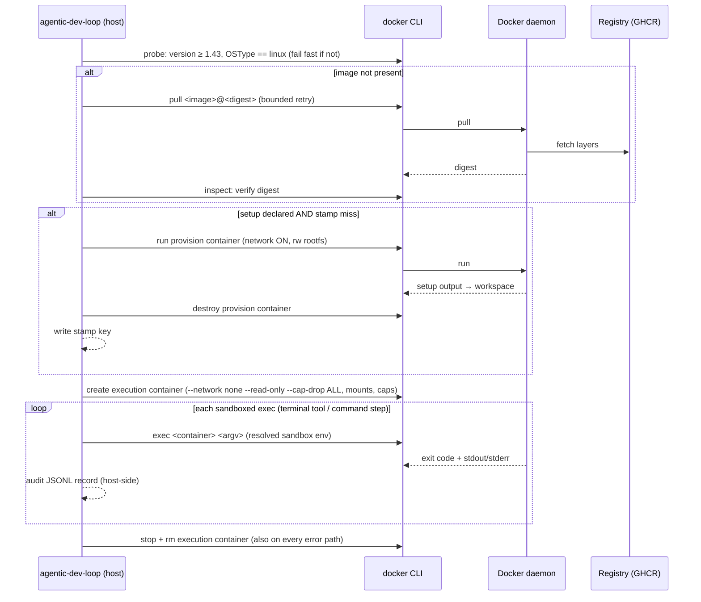

# Unit 3 Deployment Architecture — kernel-level sandboxing (always-on)

## Topology: one dev machine

Everything durable lives on the host. Containers are ephemeral; the only host-side
writes from sandboxed work land in the bind-mounted workspace (and state_dir).

## Runtime sequence

## Environment matrices

### macOS

| Aspect | Choice |
| --- | --- |
| Engines | Docker Desktop, OrbStack, Colima (any compliant daemon, ID-2) |
| Transport | unix socket via `docker` CLI |
| Mount translation | Workspace/state_dir paths passed verbatim; engine's file sharing handles uid/pid mapping |

### Windows

| Aspect | Choice |
| --- | --- |
| Engine | Docker Desktop (Linux containers mode — enforced by OSType probe) |
| Transport | npipe handled by `docker` CLI |
| Fail fast | Windows-containers mode → loud error + switch instructions (ID-2) |
| Deferred | WSL2 file-sharing path translation specifics |

### Linux

| Aspect | Choice |
| --- | --- |
| Engines | Any compliant daemon (native Docker, podman docker-compat) |
| Transport | unix socket via `docker` CLI |
| Caveat (open CG consideration) | Container-root writes may land as root-owned in workspace; `--user` mapping evaluated at Code Generation |

### CI

| Aspect | Choice |
| --- | --- |
| Runners | GitHub-hosted `ubuntu-latest` (Docker preinstalled) + `windows-latest` (Docker Desktop verified/started in workflow) |
| Scope | Full unit-test suite + marked Docker-backend integration tests (never silently skipped in CI) |
| Publish | `publish-image.yml` builds + pushes the dev image to GHCR on main |

## Fresh-machine deployment steps (what fail-fast must guide the user to)

The full walkthrough ships as the repo user guide (`docs/setup.md`, written at
Code Generation — see infrastructure-design.md ID-7). The fail-fast messages
must direct users to it, not just to the installer pages:

1. Install a compliant Docker engine (links/messages per platform) — Docker Desktop (macOS/Windows), or Docker Engine / OrbStack / Colima / podman on Linux.
2. Windows only: ensure Linux-containers mode is active.
3. Start the daemon. On first run the harness pulls the pinned dev image (digest-verified, retried); later runs reuse the local image cache.
4. `~/.agentic-dev-loop/state/` is created on first use; `--clean-stamps` removes cached provision stamps.

## Failure modes mapped to behavior

| Failure | Behavior |
| --- | --- |
| No `docker` CLI / daemon unreachable | Load-time fail fast with actionable install instructions (BR-2) |
| Engine API < 1.43 | Fail fast, name the version found and required |
| Windows-containers mode | Fail fast, switch instructions |
| Image pull failure / digest mismatch | Bounded retry, then loud failure (BR-10, SECURITY-07); no fallback image |
| Provision (`setup:`) failure | Loud step failure; stamp not written; execution container never created for that step |
| Mid-run daemon death | Loud failure; containers cleaned up where possible; no silent degradation |
| Sandboxed command nonzero exit | Propagated as step result (unchanged pipeline semantics, NFR-3.9) |

## Amendment (2026-10-19) — loop-mechanics hardening

- **Runtime sequence (eager startup, Q2)**: probe → pull (digest verify) → create+start exec container → provision all declared setups → graph build → steps (exec only) → destroy. No lazy container creation; no step-boundary provision.
- **Mount set**: workspace only (Q1); run state/audit/stamps are host-only.
- **Failure table**: + provision failure at startup aborts before any step executes (AE-SBX-009).

## Amendment (2026-10-19) — package rename

- Package references updated `agent-engine` → `agentic-dev-loop` throughout (module paths, default image `ghcr.io/lukedawilson/agentic-dev-loop/dev`, env var `AGENTIC_DEV_LOOP_DEV_IMAGE`, user state dirs `~/.agentic-dev-loop/*`). No design change.
