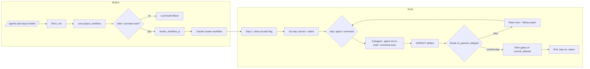

# Unit 4 Functional Design - Business Logic Model

## Core Flow

### Build time (workflow creation - happens once, Claude-with-tools)

1. User invokes `/agentic-dev-loop` (skill installed via `agentic-dev-loop install-skill`).
2. Claude follows SKILL.md and runs the projection: `python -m agentic_dev_loop.core.project <pipeline.yaml>`.
3. `project_workflow` loads + validates the pipeline (same validation as engine mode - fail fast on invalid YAML).
4. Prompt-existence check: for every `agent` step, the referenced `.agent.md` in `agents_dir` must exist - missing prompt = loud build failure (FD-1).
5. Steps are projected and baked into the workflow JS **template** → generated concrete JS, self-contained (step data + prompt references + routing + attempt counter), header records `core` version + pipeline hash (FD-5).
6. Claude creates the Claude Code workflow from the generated JS. Steps are frozen - mid-run pipeline.yaml edits do not affect a running workflow.

### Run time (workflow execution)

1. **First JS step** - capture clean-at-start: `git status --porcelain` emptiness → `commit_allowed` flag in workflow state, before any subagent work (FD-3, exact engine semantics).
2. **Viz step** - launch `python -m agentic_dev_loop.viz`, server generates an ingest token → workflow state; URL surfaced (FD-4).
3. **Per step**, in pipeline order:
   - `agent` step → subagent spawns, re-reads its `.agent.md` from the workspace (prompt reference, not embed - FD-1), produces its artifact.
   - `command` step → subagent runs the command in Claude Code's own environment; exit code = verdict (Q1/FR-4.4).
   - Verdict agents write the `VERDICT: PASS/FAIL` artifact exactly as in engine mode (Q7).
   - Each step POSTs stage events to the viz ingest endpoint (token header).
4. **Routing** - the JS routes `on_pass` / `on_fail` / `goto` using the attempt counter in workflow state; the failing subagent's final output is injected as the retry note into the next dev attempt's prompt (FD-2, mirrors the engine `notes` channel). `max_attempts` bounded; exceeding it fails the workflow loudly.
5. **Commit step** - subagent invokes the docker-free commit shim; shim refuses loudly unless `commit_allowed`; trusted hooksPath + templated message preserved (Q4/FR-4.6).
6. **End** - viz server stopped; workflow reports the run summary.

## Key Decisions

| # | Decision | Source |
| --- | --- | --- |
| KD-1 | Module split: `core` (light deps) / `engine` (heavy) / `viz` (stdlib-only), guard-tested boundaries | Q2 / FR-4.1 |
| KD-2 | No Docker sandboxing from Claude Code; workflow steps run in Claude Code's own environment | FR-4.2 / user directive |
| KD-3 | Build-time parse: steps baked at workflow creation; runtime never parses | Q3 reversal |
| KD-4 | Prompt reference + build-time existence check (never silently missing) | FD-1 |
| KD-5 | Engine-faithful retry: attempt counter + retry note from failing subagent's final output | FD-2 / Q7 |
| KD-6 | Commit gating: clean-at-start captured by the first JS step; docker-free shim reuses engine commit policy | FD-3 / Q4 |
| KD-7 | Viz: token-authenticated ingest, read-only SSE tokenless, localhost-bound | FD-4 |
| KD-8 | Skill ships in the wheel; `install-skill` → `~/.claude/skills/agentic-dev-loop/`; generated JS version-stamped | FD-5 |
| KD-9 | No MCP layer - subagents reach core/viz via shell/python | Q5 / FR-4.8 |
| KD-10 | One pipeline.yaml both modes; engine-only fields (`isolation:`, `network:`, `setup:`) ignored in workflow mode with documented semantics | FR-4.9 |

## Algorithms (pure functions, all in `core` unless noted)

| Function | Responsibility | Notes |
| --- | --- | --- |
| `project_workflow(cfg, agents_dir, pipeline_hash)` | PipelineConfig → `WorkflowProjection` (steps data, prompt refs, routing, verdict config) | Reuses existing load/validate path; fail-fast on invalid YAML |
| `validate_prompt_refs(projection, agents_dir)` | Every agent step's `.agent.md` must exist | Loud failure naming the missing file (FD-1) |
| `render_workflow_js(template, projection, core_version, pipeline_hash)` | Projection + template → concrete generated JS | Deterministic given inputs (PBT target) |
| `parse_verdict(artifact_text)` | Existing engine verdict parser, shared unchanged | Same contract both modes |
| `clean_at_start_flag(git_porcelain_output)` | Empty porcelain → `commit_allowed=True` | Mirrors engine dirty-at-start policy |
| `make_ingest_event(step, status, output)` | Shape stage event for the HTTP ingest endpoint | `viz` module |
| `issue_ingest_token()` | Random token at server launch | `viz` module |

## PBT Properties (targets for `tests/test_unit4_pbt.py`)

| Property | Invariant |
| --- | --- |
| Projection round-trip | `project_workflow` preserves step order, verdicts, `on_pass`/`on_fail`/`goto`, `max_attempts` for any valid PipelineConfig |
| Prompt-ref validation | Any agent step with a missing `.agent.md` → loud failure; present → success. Never silent. |
| Template determinism | Same (projection, version, hash) → identical generated JS; differing hash/version → differing header only |
| Verdict parse totality | `parse_verdict` returns a route for every input (unclear verdicts retry, never crash) |
| Token uniqueness | `issue_ingest_token()` never repeats across launches |
| Guard contract | `core` imports no `engine`/`viz`/heavy deps (import-graph test, not hypothesis) |
