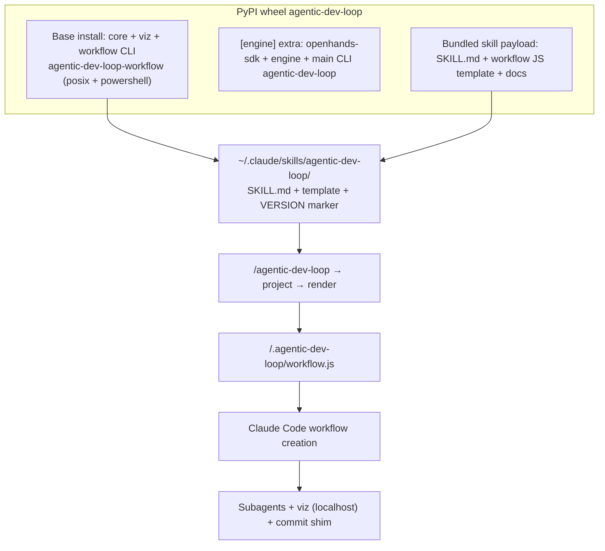

# Unit 4 Infrastructure Design - Claude Dynamic Workflows driver

## Positioning

Home comforts for devs forced onto Claude Code: export a Claude Dynamic Workflow from the pipeline.yaml they already trust, plus the visualiser they trust. We add the deterministic loop through Claude's mechanism - nothing more. No sandboxing, no added security claims.

## Topology

## Key structures

| Concern | Design |
| --- | --- |
| Extras inversion (ID-1) | Base = `core` + `viz` + `agentic-dev-loop-workflow` console script (posix + powershell). `[engine]` extra = openhands-sdk + docker-facing engine + main `agentic-dev-loop` CLI. Workflow users never pull engine deps. |
| Skill install (ID-3) | `agentic-dev-loop-workflow install-skill` copies SKILL.md + template into `~/.claude/skills/agentic-dev-loop/` idempotently (overwrite), writes a VERSION marker; skill files never user-edited. |
| Generated artifact (ID-2) | `project_workflow` + `render_workflow_js` write `.agentic-dev-loop/workflow.js` in the workspace; header = core version + pipeline hash; CC workflow-creation consumes it. |
| Version stamping | Generated JS header + skill VERSION marker both record the core version; golden tests pin template ↔ core compatibility. |
| Migration (ID-5) | Hard break; CHANGELOG old→new import table; in-repo pipeline.yaml `extensions:` strings + docs examples updated at implementation; yosk-cms upgrade note. |

## Failure modes (fail fast / fail loud)

| Failure | Behaviour |
| --- | --- |
| Missing `.agent.md` prompt | Build fails loudly, names the file (BR-4) |
| Invalid pipeline.yaml | Load-time validation error (unchanged) |
| Skill template ↔ core version drift | Golden tests fail in CI (ID-4 job) |
| `~/.claude/skills` missing/unwritable | `install-skill` errors loudly with fix instructions |
| Viz server death mid-run | Graceful degradation; run continues; events dropped (NFR-4) |
| Hidden engine import in workflow path | Workflow-mode CI job fails (ID-4) |

## Category applicability (mandatory evaluation)

| Category | Disposition | Justification |
| --- | --- | --- |
| Deployment Environment | Applicable | Dev laptops (macOS/Linux/Windows); skill install to `~/.claude/skills`; pip/uv extras install - covered by ID-1/ID-3 |
| Compute | N/A | No engine compute in workflow mode; subagents run in Claude Code's own environment (FR-4.2/BR-3) |
| Storage | N/A | No journal/no persistence by decision (NFR-4); only the transient `.agentic-dev-loop/workflow.js` artifact |
| Messaging | N/A | No queues/brokers; step events are a localhost HTTP POST stream (covered under Networking) |
| Networking | Applicable (local only) | Viz binds localhost; ingest token-authenticated; SSE read-only tokenless (BR-9) |
| Monitoring | N/A | Claude Code's own records are the audit trail (NFR-5); no added monitoring |
| Shared Infrastructure | N/A | Single-tenant local tooling; no shared infra to design |
