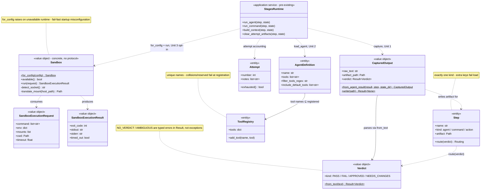

# Application Design - Guardrails & Sandboxing

Consolidated application design for the two-stage guardrails intent. Amended to comply with the loaded backend DDD rules (`coding-standards-ddd.yaml`).

## Design Decisions (Domain Exposition)

| Question | Decision |
| --- | --- |
| Q-AD1 Response-capture ownership | New component `outputs.py` - capture + verdict parsing together as the feedback domain |
| Q-AD2 Inter-stage medium | Pipeline writes the captured response to the existing artifact path (`implementation-summary.md`); writer swaps agent→pipeline, `build_context` untouched |
| Q-AD3 Tool-restriction config | `.agent.md` frontmatter only (SDK-native `tools` / `filter_tools_regex` / `include_default_tools`) |
| Q-AD4 Isolation boundary | New `isolation` component - **single concrete `Sandbox` type** (no protocol: single-impl interfaces forbidden). Docker Engine API is the abstraction; platform variance (daemon detection, mount translation, CRLF) is internal behavior. Shared interface extracted only when a second backend (e.g. native Linux namespaces - bubblewrap/Landlock) is actually implemented. **Open question for Unit 3 FD: Linux Docker vs native namespace isolation** |
| Q-AD5 Isolation test seam | No testability-driven structure (no `FakeBackend` protocol seam): unit-test pure parts (request building, result mapping, path translation); real Docker only in opt-in integration tests |
| Q-AD6 Verdict parser shape | Source-agnostic pure parser returning a **typed result object**: `Verdict.from_text(text) -> Result[Verdict]` with error codes (`NO_VERDICT` / `AMBIGUOUS`) - no exceptions for expected conditions |

## Component Landscape

- **New**: Outputs (Unit 1 feedback domain - `CapturedOutput`, `Verdict` VOs), Isolation (Unit 3 - concrete `Sandbox`)
- **Modified**: Stages Runtime (delegates capture + isolation), Agents (SDK knobs), Registry (tool-name validation), Pipeline Config (opt-in isolation section)
- **Unchanged**: Graph, Actions, Loaders, LLM, Viz, AidlcExtension

## Key Interfaces

| Interface | Signature | Stage |
| --- | --- | --- |
| Capture | `CapturedOutput.from_agent_result(result, step, state_dir) -> CapturedOutput` (static constructor) | Unit 1 |
| Parse | `Verdict.from_text(text) -> Result[Verdict]` | Unit 1 |
| Sandbox contract | `Sandbox.run(request) -> SandboxExecutionResult`; `Sandbox.for_config(config) -> Sandbox` (fail-fast) | Unit 3 |

## Domain Shape

Approved by user 2026-10-17 (change-surface diagram - covers what Units 1–3 touch; unchanged machinery is catalogued in `component-dependency.md`):

- Value objects: `Verdict`, `CapturedOutput`, `SandboxExecutionRequest`/`Result`, `Sandbox`
- Entities: `Step`, `Attempt`, `AgentDefinition`, `ToolRegistry`
- Services (exceptions only, per descent audit): **zero new** - only the pre-existing Stages Runtime orchestration
- No persistence abstractions; entities handle their own artifact persistence
- Per-unit Functional Design docs (generated during Construction) reference this diagram; unit-level detail is added there, not here

## Design Consistency Check

- **Requirements traceability**: FR-1.2/1.3 → Outputs + Stages; FR-1.4 → Agents; FR-1.5/1.6 → Stages/Actions hardening; FR-1.7 → Registry; FR-2.x → Isolation + Config. See components.md table.
- **Vertical slices**: Unit 1 = end-to-end feedback path (capture → artifact → context → verdict routing); Unit 2 = end-to-end tool-injection path (frontmatter → SDK → registry validation); Unit 3 = end-to-end sandbox path (config → sandbox → execution → result mapping). Each unit lands with its own tests green before the next starts.
- **DDD rules compliance**: no single-impl interfaces; no testability-driven structure; result objects for expected failures; fail-fast raises only for startup misconfiguration; zero new services (all operations descended onto VOs/entities); no Repository/DAO/DTO/enterprise styles.
- **Fail-fast preserved**: unknown tools, unknown actions, unavailable isolation all raise loudly at the earliest detection point.
