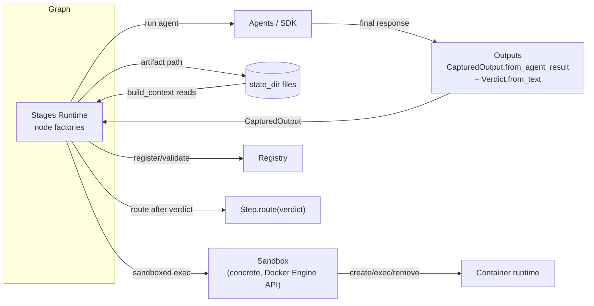

# Component Dependencies - Guardrails & Sandboxing

## Dependency Matrix

| Component | Depends on | Notes |
| --- | --- | --- |
| Outputs (`CapturedOutput`, `Verdict`) | Stages Runtime (calls it), Pipeline Config (Step entity), LLM (SDK result shape) | New; replaces agent-written reports; pure VOs + own persistence |
| Isolation (`Sandbox`) | Pipeline Config (opt-in config), Stages Runtime (calls it) | New; concrete type, no protocol; Docker client inside |
| Stages Runtime | Outputs, Isolation, Agents, Registry, Actions, Loaders, Graph | Central orchestrator - the only caller of Outputs and Isolation |
| Agents | Registry (tool names), SDK | Unit 2 wiring |
| Registry | SDK (tool registry) | Unit 2 validation |
| Graph | Stages Runtime node factories, SQLite checkpoints | Unchanged |

## Communication Patterns

- **Feedback data flow (Unit 1)**: SDK final response → `CapturedOutput.from_agent_result` → artifact file in `state_dir` → `build_context` (unchanged) → downstream agents. The *writer* changed (agent → pipeline); the *medium* did not. Verdict parsing is a pure function of the captured text, returning a typed `Result[Verdict]`.
- **Isolation data flow (Unit 3)**: Stages Runtime builds a `SandboxExecutionRequest` → `Sandbox.for_config` resolves (fail-fast if unavailable) → `Sandbox.run` → result mapped back to step semantics (exit code/timeout).
- **Coupling rules**: Outputs and Isolation are leaf collaborators of Stages Runtime - nothing else calls them; Graph never touches Docker or the SDK result directly; the SDK remains reachable only through Agents. No protocols/factories between callers and these leaves - direct construction per the DDD rules.

---

## Full Pipeline Domain Model (reference)

Approved by user 2026-10-17. Covers the entire pipeline - change surface and unchanged machinery - with Unit provenance marked in stereotypes (`<<NEW - Unit N>>`, `<<modified - Unit N>>`, `<<unchanged>>`).

> **⚠️ Future-intent note**: parts of the *existing* (unchanged) model are known to need refactoring under a **future intent**, outside the guardrails-and-sandboxing scope - e.g., `verdicts.py` parsing is absorbed into `Verdict.from_text` by Unit 1 only for the pipeline-capture path, `LoopState`/Graph state shape, viz/CLI layering. This diagram records today's structure for traceability, not as an endorsement that the unchanged parts are final.

```mermaid
classDiagram
    %% ══════════ ENTRY ══════════
    class CLI {
        <<unchanged - entry point>>
        +main()
        +flags: --plan / --ai-dlc-unit / --resume / --max-attempts / --viz-port
    }

    %% ══════════ CONFIG AGGREGATE ══════════
    class PipelineConfig {
        <<modified - Unit 3 adds opt-in isolation section>>
        +steps: dict~str, StepConfig~
        +llm: LlmConfig
        +isolation: IsolationConfig
        +state_dir: Path
        +max_attempts: int
    }
    class StepConfig {
        <<unchanged - strict schema>>
        +kind: agent / command / action
        +exactly_one_kind()
    }
    class LlmConfig {
        <<unchanged>>
        +model: str
        +base_url: str
        +api_key_env: str
        +timeout: null
    }

    %% ══════════ GRAPH / STATE ══════════
    class Graph {
        <<unchanged - LangGraph + SqliteSaver>>
        +build_graph(config, runtime)
        +run_pipeline(cfg_path, args)$ tuple
    }
    class LoopState {
        <<unchanged - state aggregate>>
        +attempts: int
        +notes: list~str~
        +docs: dict
        +commit_allowed: bool
    }
    class Attempt {
        <<entity>>
        +number: int
        +notes: list~str~
        +exhausted() bool
    }

    %% ══════════ ORCHESTRATOR ══════════
    class StagesRuntime {
        <<application service - modified Units 1+3>>
        +run_agent(step, state)
        +run_command(step, state)
        +run_action(step, state)
        +build_context(step, state)
        +clear_attempt_artifacts(step, state)
    }

    %% ══════════ AGENTS - Unit 2 ══════════
    class AgentDefinition {
        <<entity - modified Unit 2>>
        +name: str
        +tools: list~str~
        +filter_tools_regex: str
        +include_default_tools: list~str~
    }
    class ToolRegistry {
        <<entity - modified Unit 2>>
        +tools: dict
        +add_tool(name, tool)
        +validate(name)
    }

    %% ══════════ OUTPUTS - Unit 1 ══════════
    class CapturedOutput {
        <<value object - NEW Unit 1>>
        +raw_text: str
        +artifact_path: Path
        +verdict: Result~Verdict~
        +from_agent_result(result, step, state_dir)$ CapturedOutput
        +write(path)$ Result~None~
    }
    class Verdict {
        <<value object - NEW Unit 1, absorbs verdicts.py>>
        +kind: PASS / FAIL / APPROVED / NEEDS_CHANGES
        +from_text(text)$ Result~Verdict~
    }

    %% ══════════ ISOLATION - Unit 3 ══════════
    class Sandbox {
        <<value object - NEW Unit 3, concrete>>
        +for_config(config)$ Sandbox
        +available() bool
        +run(request) SandboxExecutionResult
        -detect_socket() str
        -translate_mount(host_path) Path
    }
    class SandboxExecutionRequest {
        <<value object - NEW Unit 3>>
        +command: list~str~
        +env: dict
        +mounts: list
        +cwd: Path
        +timeout: float
    }
    class SandboxExecutionResult {
        <<value object - NEW Unit 3>>
        +exit_code: int
        +stdout: str
        +stderr: str
        +timed_out: bool
    }

    %% ══════════ ACTIONS ══════════
    class CommitAction {
        <<unchanged - host-side, single point>>
        +apply(state, params)
        gated on clean-at-start worktree
    }

    %% ══════════ LOADERS ══════════
    class PlanDocumentLoader {
        <<unchanged>>
        +--plan flag
        +resolve(docs, subject)
    }
    class AidlcDocumentLoader {
        <<unchanged>>
        +--ai-dlc-unit flag
        +resolve(docs, subject)
    }
    class LoaderSelection {
        <<unchanged>>
        +select_loader(loaders, args)$
        +fail-fast: 2 flags / zero docs
    }

    %% ══════════ LLM ══════════
    class LlmFactory {
        <<unchanged>>
        +build_llm(config)$
        +fail-fast: missing api_key_env
        +compat shims (COMPAT-SHIMS.md)
    }

    %% ══════════ VIZ ══════════
    class VizBus {
        <<unchanged>>
        +publish(event)
    }
    class VizServer {
        <<unchanged - localhost-only>>
        +serve_viz(port)
    }

    %% ══════════ EXTENSIONS ══════════
    class ExtensionRegistry {
        <<modified - Unit 2 tool-name validation>>
        +add_action(name, fn)
        +add_tool(name, tool)
        +add_document_loader(loader)
        +load_extensions(specs)$
    }
    class AidlcExtension {
        <<unchanged>>
        +register(registry)
    }

    %% ══════════ RELATIONSHIPS ══════════
    CLI --> PipelineConfig : loads
    CLI --> LoaderSelection : selects via flags
    CLI --> Graph : run_pipeline
    Graph --> LoopState : checkpoints per stage
    Graph --> StagesRuntime : node factories
    PipelineConfig --> StepConfig : defines
    PipelineConfig --> LlmConfig
    LoopState --> Attempt : attempt accounting

    StagesRuntime ..> AgentDefinition : load_agent
    StagesRuntime ..> CapturedOutput : capture, Unit 1
    StagesRuntime ..> Sandbox : for_config + run, Unit 3 opt-in
    StagesRuntime ..> CommitAction : action steps
    StagesRuntime ..> Verdict : parse → route
    StagesRuntime ..> LlmFactory : build_llm at startup

    CapturedOutput --> Verdict : from_text
    StepConfig ..> Verdict : route(verdict)
    AgentDefinition --> ToolRegistry : tool names ⊆ registered

    ExtensionRegistry ..> ToolRegistry : registers tools
    ExtensionRegistry ..> LoaderSelection : registers loaders
    AidlcExtension ..> ExtensionRegistry : register()

    Sandbox ..> SandboxExecutionRequest : consumes
    Sandbox ..> SandboxExecutionResult : produces
```

Reading: stereotype = provenance; solid arrows = containment (config→steps, state→attempts, output→verdict); dotted arrows = dependencies. StagesRuntime is the hub of every Unit-N edge - all three units land as modifications to the one pre-existing orchestrator plus leaf value objects, never new coordination layers.
