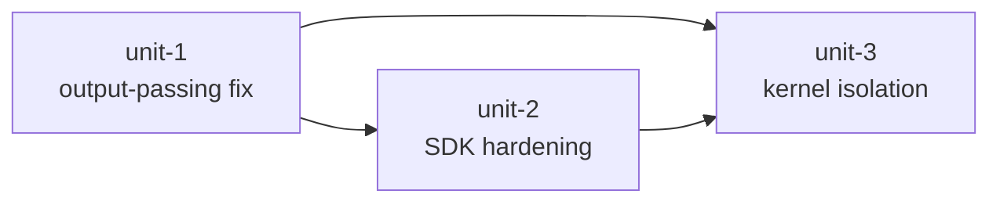

# Unit of Work Dependencies

## Dependency Matrix

| Unit | Depends on | Depended on by | Coupling type |
| --- | --- | --- | --- |
| unit-1 | — (green) | unit-2, unit-3 | None — lands first |
| unit-2 | unit-1 (capture path is live; tool surface it hardens is post-U1) | unit-3 | Interface — U3 re-locates the command/terminal shapes U2 hardened |
| unit-3 | unit-1 (`CapturedOutput`/`Verdict` shapes), unit-2 (`_run_command` argv shape, validated `ToolRegistry`) | — (terminal) | Interface — `Sandbox` plugs into `StagesRuntime` without changing U1/U2 contracts |

## Dependency Graph

Strict sequence 1 → 2 → 3. U3 consumes U1 (capture) and U2 (command shape) contracts; U1 and U2 never see U3's Sandbox type.

## Coupling Rules (from Application Design)

- `Outputs` (U1) and `Isolation` (U3) are **leaf collaborators of `StagesRuntime` only** — no other component imports them.
- No protocols between callers and leaves: `Sandbox` is concrete; Docker Engine API is the abstraction (FR-2.2); platform variance is internal behavior (`detect_socket`, `translate_mount`).
- `ExtensionRegistry` (U2) and `ToolRegistry` (U2) validate names at registration time — fail fast at load, never at runtime.
- Shared serialisation module: config ↔ domain object (de)serialisation for `isolation:` section lives in the config module per DDD standards.

## Validation (per plan)

- Boundaries: each unit compiles, tests, and ships independently; U1 lands with its own test suite (capture/parse fixtures), U2 with tool-registry/command tests, U3 with opt-in integration tests (real Docker, not faked).
- No unit touches a module that isn't in its responsibility table (e.g. U1 does not modify `run_command`; U2 does not add the `isolation:` config section).
- All FR/NFR assigned — see story map.
