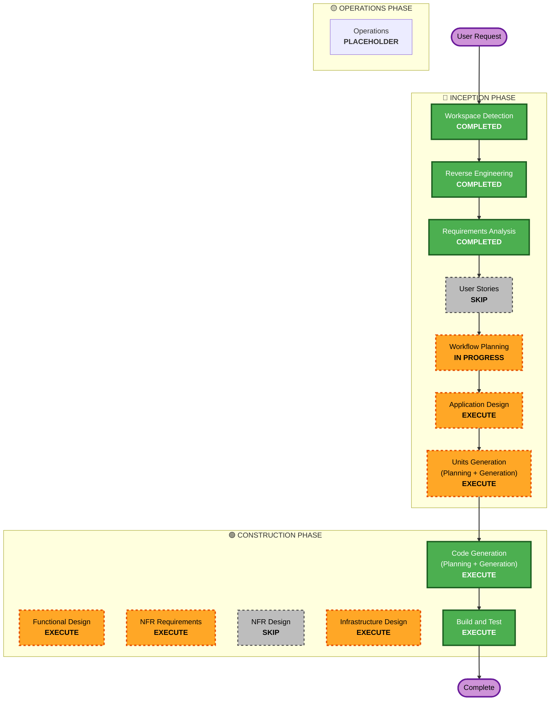

# Execution Plan

## Detailed Analysis Summary

### Transformation Scope (Brownfield)

- **Transformation Type**: Architectural enhancement — hardening + new optional isolation subsystem (no deployment-model change; library + CLI remain the product)
- **Primary Changes**: (1) findings/verdict-passing mechanism reworked to pipeline-captured final responses; (2) SDK tooling-injection hardening; (3) opt-in container isolation for terminal tool + command steps
- **Related Components**: single package (`agent-engine`) + shipped consumer example (`agent-engine/pipeline.yaml`, `sdk_agents/*`); no infra code, no CDK, no shared models

### Change Impact Assessment

- **User-facing changes**: Yes — pipeline authors' YAML/agent files change (verdict protocol semantics, `file_editor` removal, optional isolation config)
- **Structural changes**: Yes — new isolation subsystem (Unit 3); stages/verdicts flow reworked (Unit 1)
- **Data model changes**: Minor — state_dir artifact semantics; no DB schema
- **API changes**: Yes — `run_agent` capture path, verdict parsing interface, new config fields
- **NFR impact**: Yes — security (isolation, least privilege), resiliency (scoped: container lifecycle retries)

### Component Relationships

- **Primary Component**: `src/agent_engine/` (stages, verdicts, agents, registry, config, graph)
- **Dependent Components**: shipped consumer (`agent-engine/` example), `tests/` (e2e fixtures replay historical verdict failures — will need updating for the new capture mechanism)
- **Supporting Components**: `viz.py` (observes state), `extensions/aidlc.py` (loader layout)

### Risk Assessment

- **Risk Level**: Medium — multiple components; Unit 3 (kernel isolation) carries the most risk (cross-platform container behavior), but is opt-in and separable; Unit 1 first per user directive
- **Rollback Complexity**: Easy — git-versioned single package, no schema/data migration
- **Testing Complexity**: Moderate — e2e fixture suite replays historical parsing edge cases; container tests need a fake-runtime seam

## Workflow Visualization

## Phases to Execute

### 🔵 INCEPTION PHASE

- [x] Workspace Detection (COMPLETED)
- [x] Reverse Engineering (COMPLETED)
- [x] Requirements Analysis (COMPLETED)
- [x] User Stories (SKIPPED)
  - **Rationale**: Internal dev-tool hardening — user confirmed "No need for user stories"
- [x] Execution Plan (IN PROGRESS)
- [ ] Application Design - EXECUTE
  - **Rationale**: New isolation component (Unit 3) needs component definition; Domain Standards extension demands domain exposition before any model proposal
- [ ] Units Generation - EXECUTE
  - **Rationale**: Three units, complex changes; user directive: units are vertical slices

### 🟢 CONSTRUCTION PHASE

- [ ] Functional Design - EXECUTE
  - **Rationale**: Unit 1 parsing-logic redesign explicitly flagged by user ("we've had bugs in this area"); domain exposition + validation per Domain Standards
- [ ] NFR Requirements - EXECUTE
  - **Rationale**: Security baseline is blocking; isolation/least-privilege/credential NFRs must be pinned before code
- [ ] NFR Design - SKIP
  - **Rationale**: No performance/scaling/HA design work; desktop tool; container infra handled by Infrastructure Design
- [ ] Infrastructure Design - EXECUTE
  - **Rationale**: Unit 3 introduces container-runtime infrastructure (daemon detection, mounts, images) needing design
- [ ] Code Generation - EXECUTE (ALWAYS)
- [ ] Build and Test - EXECUTE (ALWAYS)

### 🟡 OPERATIONS PHASE

- [ ] Operations - PLACEHOLDER

## Package Change Sequence (Brownfield Only)

Single package (`agent-engine`) — no multi-package coordination. Unit order is the critical path: **Unit 1 (findings/verdict passing) → Unit 2 (tool hardening) → Unit 3 (kernel isolation)**; each is a vertical slice with its own build-and-test checkpoint.

## Estimated Timeline

- **Total Phases**: 12 planned stages (incl. per-unit construction loop for 3 units)
- **Estimated Duration**: Unit 1 (small, well-understood) < Unit 2 (medium) < Unit 3 (large, cross-platform unknowns)

## Success Criteria

- **Primary Goal**: agent-engine runs guardrailed by design — reliable findings/verdict passing, hardened tool injection, opt-in kernel isolation
- **Key Deliverables**: response-capture mechanism + parsing redesign (Unit 1); SDK restriction exposure + extension registration validation (Unit 2); container isolation backend with fail-fast semantics (Unit 3)
- **Quality Gates**: full test suite green per unit; e2e fixtures updated for new capture path; PBT on parsing/serialization; security NFRs verified

- **Integration Testing**: All components working together — pipeline self-run (dev→test→review→qa→commit) under hardened + isolated modes
- **Operational Readiness**: N/A (library; container lifecycle retries + observability of sandboxed execution per Resiliency scoped)
