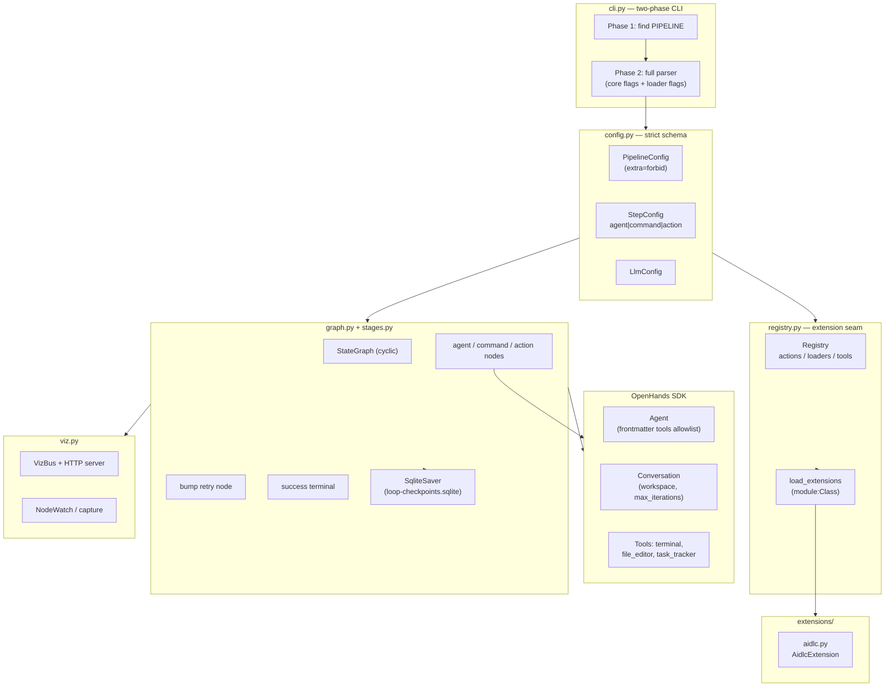
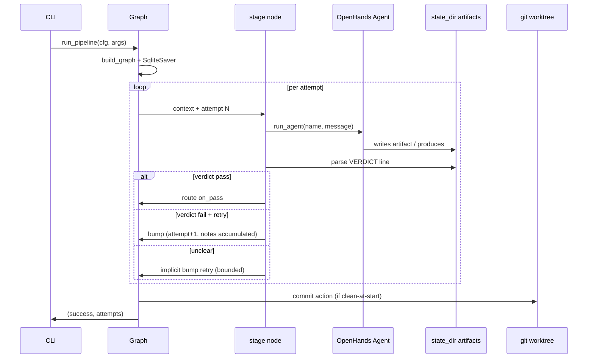

# System Architecture

## System Overview

agent-engine is a single Python library + CLI. The CLI (`agent-engine PIPELINE`) loads a pipeline YAML, builds a cyclic LangGraph state graph (one node per step plus a retry `bump` node and a `success` terminal), and runs it against the OpenHands SDK, which executes LLM-driven agents with terminal/file-editor tools. A SQLite checkpointer makes runs crash-resumable. Extensions contribute actions, SDK tools, and document loaders through a registry.

## Architecture Diagram

## Component Descriptions

### cli.py
- **Purpose**: Entry point; two-phase argument handling.
- **Responsibilities**: core flags (`--resume`, `--max-attempts`, `--no-viz`, `--viz-port`), loader-contributed flags per pipeline, exit code 0/1.
- **Dependencies**: config, graph, registry.
- **Type**: Application

### config.py
- **Purpose**: Strict YAML schema.
- **Responsibilities**: step-shape validation (exactly one kind key; command steps cannot carry artifact/verdicts/produces/params/max_iterations; artifact↔verdicts pairing; timeout requires command), duplicate step names, route targets, reserved terminal names.
- **Dependencies**: pydantic, yaml.
- **Type**: Model

### graph.py
- **Purpose**: Config-driven LangGraph builder + `run_pipeline` public API.
- **Responsibilities**: node/edge assembly, retry cycle, checkpointing, resume (including hard-failure re-entry), doc resolution, viz wiring, commit_allowed computation before checkpointer dirties the worktree.
- **Dependencies**: langgraph, stages, config, llm, loaders, registry, viz, actions.
- **Type**: Application

### stages.py
- **Purpose**: Stage nodes, routers, `run_agent` port.
- **Responsibilities**: agent/command/action node closures, verdict reading, unclear-verdict retry, attempt hygiene (`clear_attempt_artifacts`), command timeout with process-group SIGKILL, notes accumulation, deterministic routing.
- **Dependencies**: openhands-sdk, langgraph, agents, config, registry, verdicts.
- **Type**: Application

### agents.py
- **Purpose**: Agent file loading + SDK factory mechanics.
- **Responsibilities**: `load_agent` — file must exist (fail fast), frontmatter name must match filename, tools resolved against the SDK's global registry (unknown → ValueError). Imports register `terminal`, `file_editor`, `task_tracker`.
- **Dependencies**: openhands-sdk, openhands-tools.
- **Type**: Application

### registry.py
- **Purpose**: Extension seam between core and consumers.
- **Responsibilities**: action registration (duplicate → error), document loader registration with CLI-option collision detection, SDK tool registration via `register_tool`, `default_registry` (commit action + plan loader), `load_extensions` fail-fast.
- **Dependencies**: argparse, importlib, openhands-sdk.
- **Type**: Application

### actions.py
- **Purpose**: Built-in pipeline actions (node-shaped).
- **Responsibilities**: `commit` (single commit point, gated on clean-at-start worktree), `git_worktree_clean`, orphaned viz-listener sweep (`kill_listeners_on_port` with positive-only cwd attribution).
- **Dependencies**: git CLI, lsof, ps.
- **Type**: Application

### llm.py
- **Purpose**: LLM construction from config.
- **Responsibilities**: fail-fast on missing api_key_env (no silent fallbacks), two import-time SDK compat shims (DeepSeek reasoning-content registration + reasoning passback repair), no-timeout default.
- **Dependencies**: openhands-sdk.
- **Type**: Application

### loaders.py
- **Purpose**: Built-in `plan` document loader + selection flow.
- **Responsibilities**: `select_loader` coexistence model (flag selects; two loaders' flags → error; sole defaultable autodetect; none → no docs).
- **Dependencies**: registry.
- **Type**: Application

### verdicts.py
- **Purpose**: Verdict-line parsing.
- **Responsibilities**: last decoration-tolerant `VERDICT: X` line wins; caveat delimiters; negation handling on two-key sets; bare-prose rejection.
- **Dependencies**: none (pure).
- **Type**: Model

### viz.py (1,148 LOC)
- **Purpose**: Live graph visualization.
- **Responsibilities**: HTTP server on localhost (default port 8321), live event bus, node watching, console capture, Mermaid topology, heartbeat.
- **Dependencies**: http.server, threading.
- **Type**: Application

### extensions/aidlc.py
- **Purpose**: Bundled AI-DLC document loader extension.
- **Responsibilities**: `--ai-dlc-unit` flag + bare-run autodetect from aidlc-state.md; unit doc resolution with inception docs and code-generation plans.
- **Dependencies**: registry.
- **Type**: Client

## Data Flow

## Integration Points

- **External APIs**: OpenHands SDK (agent execution), LLM provider HTTP API (DeepSeek, configured via base_url/model/api_key_env).
- **Databases**: SQLite checkpointer (`<state_dir>/loop-checkpoints.sqlite`) — one per workspace.
- **Third-party Services**: none beyond the LLM provider.

## Infrastructure Components

- **CDK Stacks**: none.
- **Deployment Model**: pip-installable library (`agent-engine` console script); runs in-process on the operator's machine; no server deployment.
- **Networking**: localhost-only viz HTTP server (127.0.0.1, default port 8321, auto-opens browser); outbound HTTPS to the LLM provider.

## Security-Relevant Architecture Notes (for the guardrails/sandboxing intent)

- **Tool injection path**: `pipeline.yaml extensions:` → `load_extensions` → `registry.add_tool` → SDK global tool registry → agent frontmatter `tools:` allowlist → `load_agent` → `agent_definition_to_factory`. Tool names in frontmatter are resolved against the SDK's GLOBAL registry (any extension can register anything; no namespacing).
- **Shell execution surfaces**: (1) agent `terminal` tool — full host-user shell authority; (2) command steps — `subprocess.Popen(..., shell=True, start_new_session=True)` in the workspace; (3) `actions.py` git/lsof/ps subprocess calls. The prompt-level tool allowlist restricts what agents are OFFERED, not what granted tools can do.
- **Filesystem authority**: agents run with `workspace=` set, but `terminal` can reach the entire host filesystem; artifacts live in `state_dir`.
- **The SDK's `llm_security_analyzer`** is advisory prompt text, not enforcement.
