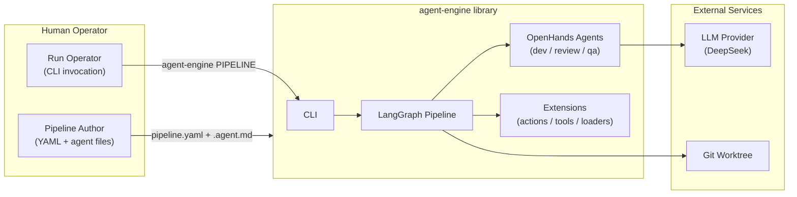

# Business Overview

## Business Context Diagram

## Business Description

- **Business Description**: agent-engine is an opinionated pipeline library + CLI that runs **stage-gated autonomous development loops**. A human declares a YAML pipeline of steps; the engine executes them with LLM-driven agents (build work), mechanical shell gates (test work), and Python action functions (commit work), with attempt-bounded retries, verdict-based routing, crash-safe checkpointing, and a fixed set of safety policies.
- **Business Transactions**:
  1. **Pipeline construction (construct run)** — load a pipeline YAML, resolve a doc bundle + subject via a document loader, and run the step graph until success or attempt exhaustion. The shipped consumer self-constructs the agent-engine repo (dev → test → review → qa → commit).
  2. **Pipeline resumption (resume run)** — re-enter a checkpointed run by thread id at the first stage that did not complete (crash/Ctrl-C/exhaustion recovery).
  3. **Extension registration (extension load)** — consumers contribute actions, SDK tools, and document loaders via `module:Class` references, with fail-fast on any load problem.
  4. **Auto-commit (single commit point)** — commit constructed work exactly once, only when the worktree was clean at run start.
- **Business Dictionary**:
  - **Step** — one unit of pipeline work, exactly one of agent/command/action kind.
  - **Attempt** — one pass through the retry cycle; `max_attempts` bounds every loop.
  - **Verdict** — the routing signal parsed from a step artifact (`VERDICT: X` line) or a command exit code.
  - **Artifact** — a hygiene-tracked output file in `state_dir`; optionally verdict-parsed.
  - **Subject** — the human-meaningful label of what is being constructed (from the doc loader).
  - **Note** — accumulated attempt feedback carried into the next attempt's context.
  - **Extension** — a consumer class contributing actions/tools/loaders to a run.

## Component Level Business Descriptions

### agent-engine (library)
- **Purpose**: The engine itself — config schema, graph builder, stage nodes, routing, retries, checkpoints, live viz, CLI.
- **Responsibilities**: strict YAML validation, agent/command/action execution, verdict parsing, attempt hygiene, crash-safe resume, extension registry.

### agent-engine (consumer example)
- **Purpose**: A shipped self-hosting example: the repo constructs itself through its own pipeline.
- **Responsibilities**: demonstrates pipeline.yaml, agent files, the ai-dlc loader, and the commit action end-to-end.

### aidlc-docs + .aidlc (AI-DLC workflow)
- **Purpose**: The AI-DLC ruleset and working docs that generate the plans consumed by the pipeline's ai-dlc document loader.
- **Responsibilities**: inception artifacts (requirements, stories, design, units), construction plans, state tracking.
